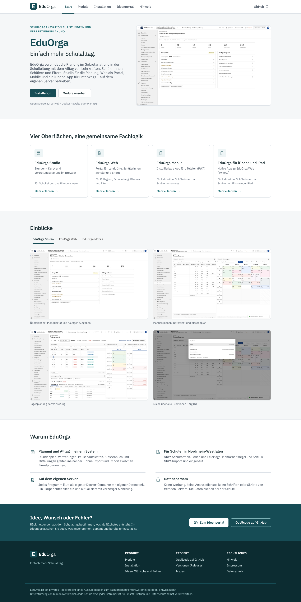

# EduOrga

**Einfach mehr Schulalltag.** EduOrga (EDO) plant Stunden- und Vertretungspläne im Browser und bringt jede Änderung zu
Kollegium, Schülerinnen, Schülern und Eltern – auf PC, Tablet und Telefon. Mit digitalem Klassenbuch (Lehrstoff,
Anwesenheit, Hausaufgaben, Prüfungen direkt aus der Stunde), Elternsprechtag, Mitteilungen und Druck als PDF. Betrieben
auf dem eigenen Server mit Docker, ohne Cloud-Pflicht, ohne Telemetrie – mit offenem Quellcode.



## Anwendungen und Stand

| Anwendung | Für wen | Stand | Ordner |
|---|---|---|---|
| **EduOrga Studio** | Stunden-, Kurs- und Vertretungsplanung im Browser – für Schulleitung und Planungsteam | verfügbar (Entwicklungsstand) | [`studio/`](studio/README.md) |
| **EduOrga Web** | Portal: Pläne, Vertretungen, Klassenbuch, Kommunikation, Sprechtag – für Lehrkräfte, Schüler*innen und Eltern | verfügbar (Entwicklungsstand) | [`web/`](web/README.md) |
| **EduOrga Mobile** | installierbare App fürs Telefon (PWA) zu EduOrga Web, auf iPhone und Android | verfügbar (Entwicklungsstand) | [`mobile/`](mobile/README.md) |
| **EduOrga für iPhone und iPad** | native App (SwiftUI, iOS 18+) | **noch nicht im App Store veröffentlicht** – Bauen mit Xcode 26 | [`ios/`](ios/README.md) |
| **EduOrga für Android** | native App | **in Arbeit** – bis dahin EduOrga Mobile | – |

## Dokumentation

| Thema | Dokument |
|---|---|
| Installation Schritt für Schritt (Voraussetzungen, HTTPS, erster Login, Studio mit Web verbinden) | [`docs/INSTALLATION.md`](docs/INSTALLATION.md) |
| Betrieb: Update, Sicherung, Wiederherstellung, Einstellungen, Fehlerbehebung | [`docs/BETRIEB.md`](docs/BETRIEB.md) |
| Benutzerhandbuch EduOrga Studio | [`docs/HANDBUCH.md`](docs/HANDBUCH.md) |
| Datenschutz: Leitfaden für Schulen in NRW, Vorlagen (Verzeichnis, TOM, AV-Vertrag) | [`docs/datenschutz/`](docs/datenschutz/README.md) |
| Skripte und Container im Einzelnen | [`installation/README.md`](installation/README.md) |
| Produkt-Website mit Überblick, Installation und Dokumentation je Anwendung | [`website/`](website/README.md) (Seiten `/`, `/installation`, `/dokumentation`, `/rueckmeldung`) |

## Rückmeldung: Ideen, Wünsche und Fehler auf GitHub

* **[Fehler melden](https://github.com/florians25/EduOrga/issues/new?template=fehler.yml)** – Formular mit Anwendung
  (Studio, Web, Mobile, iOS, Installation), Version, Schritten, erwartetem und tatsächlichem Verhalten, Bildschirmfotos
* **[Idee oder Wunsch](https://github.com/florians25/EduOrga/issues/new?template=wunsch.yml)**
* **[Fragen und Austausch](https://github.com/florians25/EduOrga/discussions)** ·
  [alle Vorlagen](https://github.com/florians25/EduOrga/issues/new/choose)

Bitte keine personenbezogenen Daten von Schülerinnen, Schülern, Eltern oder Lehrkräften und keine Passwörter einstellen.

## Installation

Jedes Programm läuft als eigener Docker-Container; Studio und Web haben jeweils eine eigene Datenbank.

```sh
mkdir -p /opt/untplannext && cd /opt/untplannext
curl -fsSL -H "Accept: application/vnd.github.raw" -o install.sh "https://api.github.com/repos/florians25/EduOrga/contents/installation/install.sh?ref=master"
sh install.sh      # Einrichtung mit Rückfragen (Programme, Datenbank, HTTPS)
./update.sh        # Update mit vorheriger Sicherung beider Datenbanken
./passwort.sh web  # Passwort neu setzen
```

Schritt für Schritt: [`docs/INSTALLATION.md`](docs/INSTALLATION.md). Technische Kennungen (Images `untplannext-*`,
Ordner `/opt/untplannext`, Variablen `UNTPLANWEB_*`/`STUDIO_*`) bleiben vorerst unverändert, damit laufende
Installationen ohne Umzug weiterarbeiten ([`design/MARKE.md`](design/MARKE.md)).

**Neue Version veröffentlichen:** Versionsnummer in `VERSION` setzen, committen und `git tag v1.2.0 && git push origin
v1.2.0`. Die Abläufe bauen die Images `ghcr.io/florians25/untplannext-*` mit den Tags `1.2.0`, `stable` und `latest`
und legen das GitHub-Release an; Administratoren von Studio und Web sehen daraufhin den Hinweis auf die neue Version.
Builds vom Branch `master` tragen `<VERSION>-dev.<Lauf>` und erzeugen keinen Hinweis.

Alle Oberflächen folgen einem gemeinsamen Designsystem ([`design/DESIGN.md`](design/DESIGN.md), Marke
[`design/MARKE.md`](design/MARKE.md)): Petrol #164C55, IBM Plex Sans, einheitliche Kennzeichnung von Änderung, Entfall,
offener Vertretung, Prüfung und Termin – Kontraste nach WCAG 2.1 AA, Status nie nur über Farbe.

## Datenschutz

Die Schule ist Verantwortliche für alle Daten in EduOrga; die Programme laufen auf dem Server der Schule bzw. ihres
Betreibers, ohne Cloud, Telemetrie, Tracking oder Inhalte von fremden Servern. Leitfaden für Schulen in NRW (Rollen,
DSGVO, SchulG NRW §§ 120–122, VO-DV I/II, Löschfristen, DSFA, Schritte bis zum Start) mit Vorlagen für das Verzeichnis
von Verarbeitungstätigkeiten, die technischen und organisatorischen Maßnahmen und einen AV-Vertrag:
**[`docs/datenschutz/`](docs/datenschutz/README.md)**. In EduOrga Web unter *Verwaltung → Datenschutz*: Aufbewahrung &
Löschung mit Fristen und Löschprotokoll, Auskunft und Löschung von Personen, Datenschutzhinweise (`/datenschutz`).

## Funktionen

- **Schuldaten:** Schuljahr, NRW-Schulformen, Zeitraster mit Vormittag, Nachmittag, fixer oder flexibler Mittagspause und Pausen, NRW-Ferien und -Feiertage (inkl. beweglicher Feiertage), A/B-Wochen, Perioden.
- **Stammdaten:** Klassen, Lehrkräfte, Räume, Fächer, Raumgruppen, Aufsichtsbereiche, Abteilungen, Abwesenheitsgründe, Schülerinnen und Schüler – mit Tabellenbearbeitung, Mehrfachänderung, Kommentaren und Umbenennen mit Verweisanpassung.
- **Zeitwünsche:** bestimmte (−3 … +3, Kernzeit) und unbestimmte Zeitwünsche, z. B. „ein freier Vormittag“.
- **Unterricht:** einfacher und gekoppelter Unterricht, Doppelstunden, Blöcke, Kursbänder, A/B-Wochen, befristeter Unterricht.
- **Automatische Planung:** Gewichtung (26 Kriterien), mehrere Verfahren mit Ergebnisvergleich und Bewertungszahl, Tausch- und Raumoptimierung, Diagnose der Eingabedaten und des Plans.
- **Manuelles Planen:** Verplanen, Verschieben und Tauschen per Drag & Drop mit Zielanzeige, Fixieren, Entplanen, Tauschvorschläge, Raumzuordnung, Gesamtübersichten.
- **Stundenpläne:** Klassen-, Lehrkraft-, Raum- und Fachpläne, eigene Formate, Druck als PDF, HTML-Aushang, iCal.
- **Vertretungsplanung:** Abwesenheiten von Lehrkräften, Klassen und Räumen, automatisch erzeugte offene Vertretungen, Vertretungsvorschlag mit Gewichtung, Bereitschaften, Entfall-Vorschlag ab EF, Verlegung, Betreuung, Sondereinsätze, Klausuren, Tagestexte, automatische Vertretung ganzer Tage.
- **Pausenaufsichten:** Aufsichtsbereiche × Pausen × Tage, automatische Einteilung, Aufsichtsvertretungen.
- **Auswertung:** Soll/Ist, Unterrichtsmatrix, Stundentafel, Vertretungsstatistik mit der **NRW-Mehrarbeitsregel** (Vergütung ab mehr als 3 Stunden im Kalendermonat, abzüglich Minderstunden), Ausfallstatistik, CSV.
- **Oberstufe:** Kurswahlen, Kollisionsmatrix, automatische Bandbildung.
- **Mehrbenutzerbetrieb:** mehrere Planende gleichzeitig, Bereichssperren, Exklusivbetrieb, Gruppen und Rechte.
- **Import und Export:** SchILD-NRW-CSV (Lehrkräfte, Klassen, Schüler), BAL, GPU-Textdateien (Datenübernahme beim Umstieg), HTML, iCal, CSV.
- **EduOrga Web:** Pläne und Vertretungen veröffentlichen, Abwesenheitsmeldungen, Raumbuchungen und Klausuren zurückholen. Die Schnittstelle steht in [docs/SYNC_API.md](docs/SYNC_API.md).

Die Bedienung von Studio beschreibt das **[Benutzerhandbuch](docs/HANDBUCH.md)**; Installation und Betrieb stehen in
[`docs/INSTALLATION.md`](docs/INSTALLATION.md) und [`docs/BETRIEB.md`](docs/BETRIEB.md).

## Aufbau

```text
src/UntPlan.Core            Fachlogik (Modell, Optimierung, Vertretungsplanung, Module, Import/Export) – net8.0
src/UntPlan.Web.Contracts   gemeinsame Datenverträge Studio ↔ Web
src/UntPlan.Portal          Referenzserver der Synchronisationsschnittstelle
studio/                     EduOrga Studio (ASP.NET Core + React-Oberfläche)
web/                        EduOrga Web
mobile/                     EduOrga Mobile (PWA)
ios/                        EduOrga für iPhone und iPad (SwiftUI; frühere App archiviert in archiv/ios-alt/)
design/                     Designsystem: Grundwerte, Schrift, Signet
installation/               Gesamtinstallation mit Docker (install.sh, update.sh, passwort.sh, docker-compose.yml)
website/                    Produkt-Website (React, kleiner ASP.NET-Server; nicht Teil der Installation an Schulen)
docs/                       Handbuch, Installation, Betrieb, Datenschutz, Schnittstellen
tests/                      xUnit-Tests der Fachlogik
```

```bash
dotnet test tests/UntPlan.Core.Tests
cd studio/src/UntPlanStudio && STUDIO_ADMIN_PASSWORT=geheim123 ASPNETCORE_URLS=http://127.0.0.1:5501 dotnet run
```

Jede Oberfläche wird als Container-Image gebaut (GitHub Actions: `studio.yml`, `web.yml`, `mobile.yml`); Installation und
Betrieb stehen in der README des jeweiligen Ordners. Schuldateien (`*.up`) sind JSON-Dateien.

## Lizenzen von Drittbestandteilen

- IBM Plex Sans – SIL Open Font License 1.1 (`design/fonts/OFL.txt`)
- Lucide-Symbole – ISC-Lizenz (`design/LUCIDE-LICENSE.txt`)

## Hinweis

> EduOrga ist ein privates Hobbyprojekt eines Auszubildenden zum Fachinformatiker für Systemintegration, entwickelt mit
> Unterstützung von Claude (Anthropic). Jede Schule bzw. jeder Betreiber ist für Einsatz, Betrieb und Datenschutz
> selbst verantwortlich.

EduOrga ist ein eigenständiges Programm und steht in keiner Verbindung zu Herstellern anderer Stundenplanprogramme.
Import-Formate anderer Programme dienen ausschließlich der Datenübernahme beim Umstieg.
