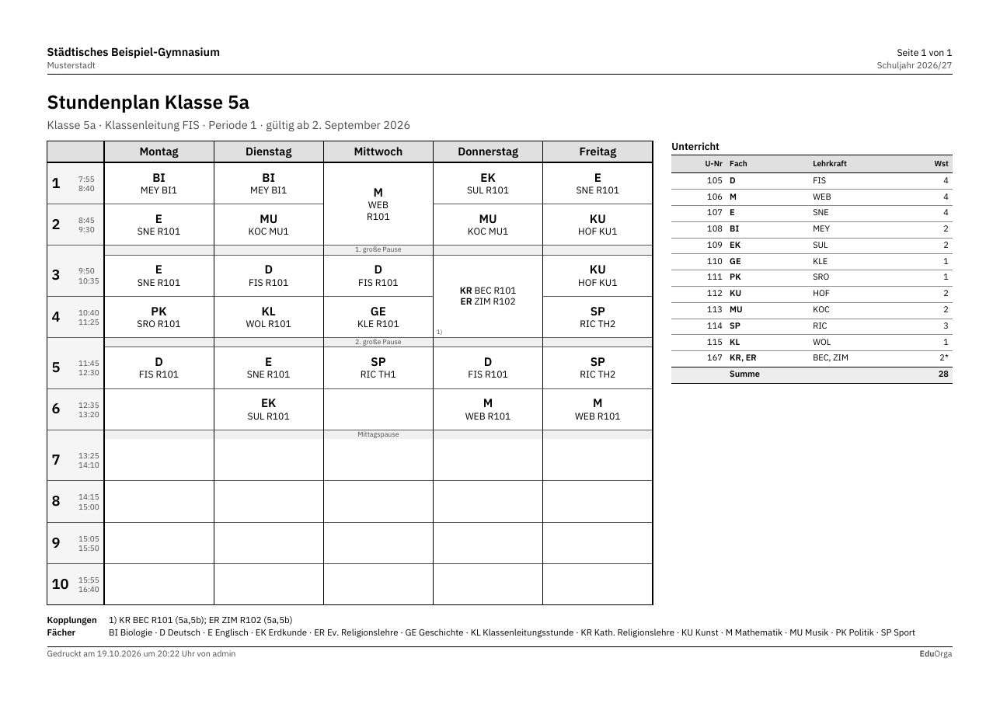
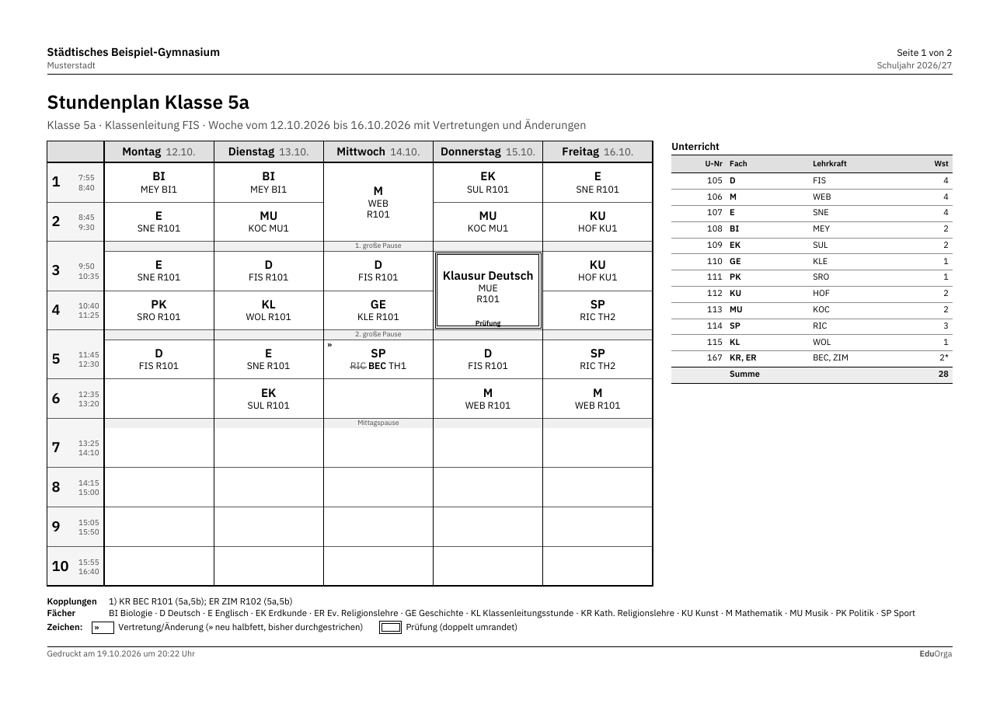
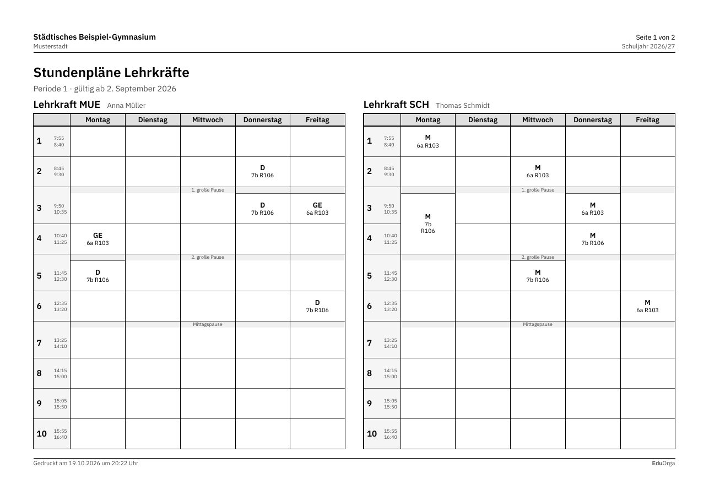
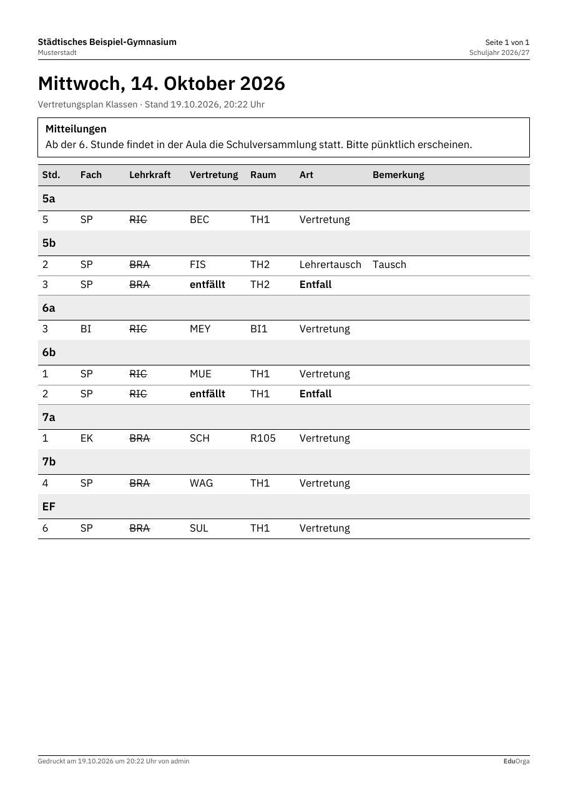
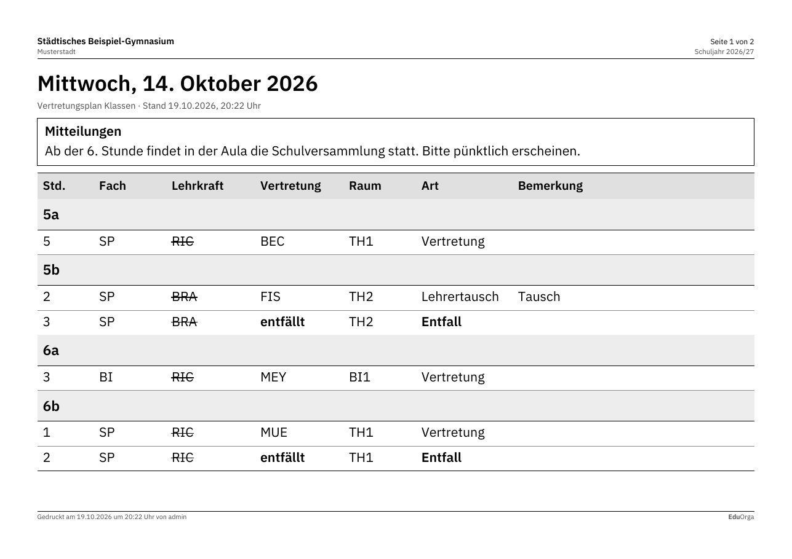
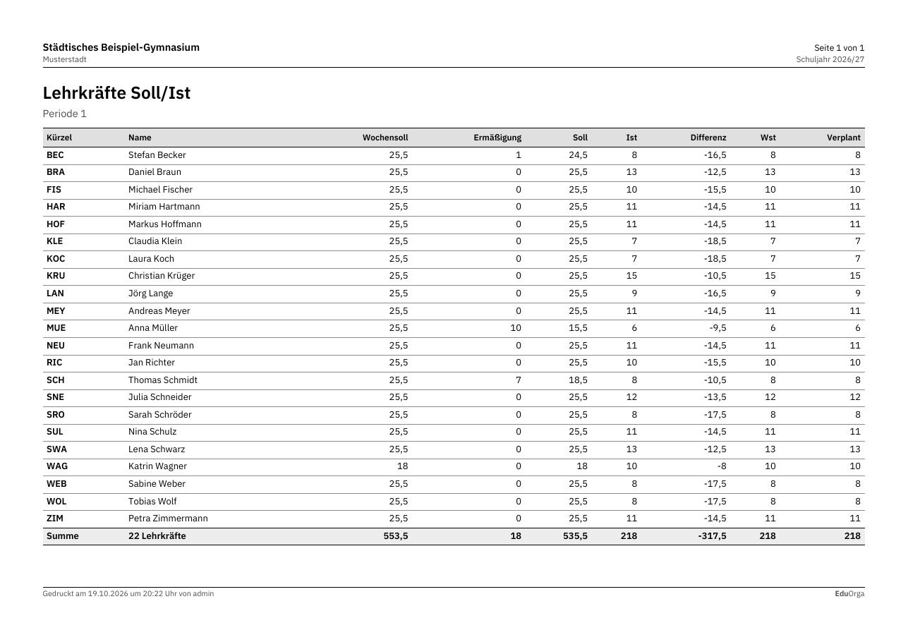
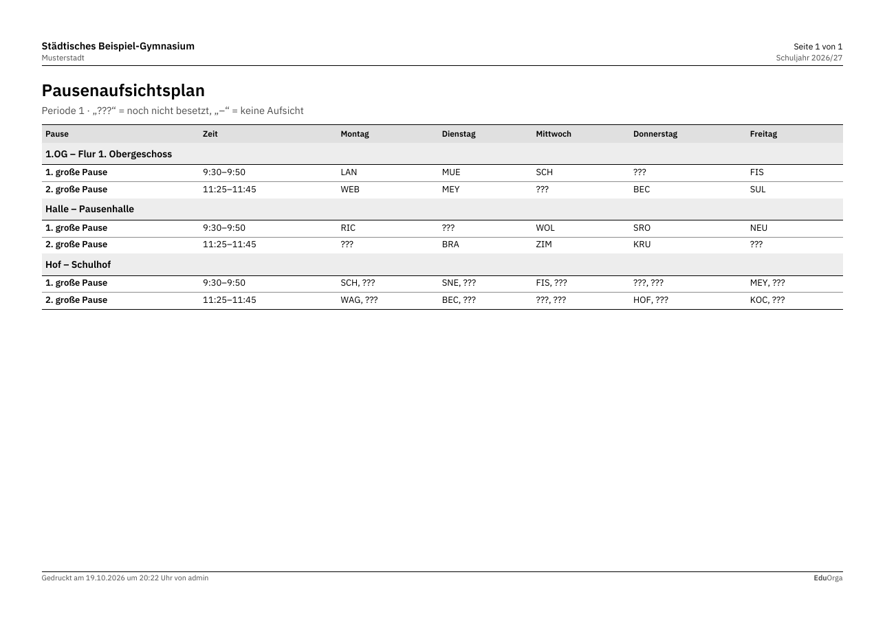
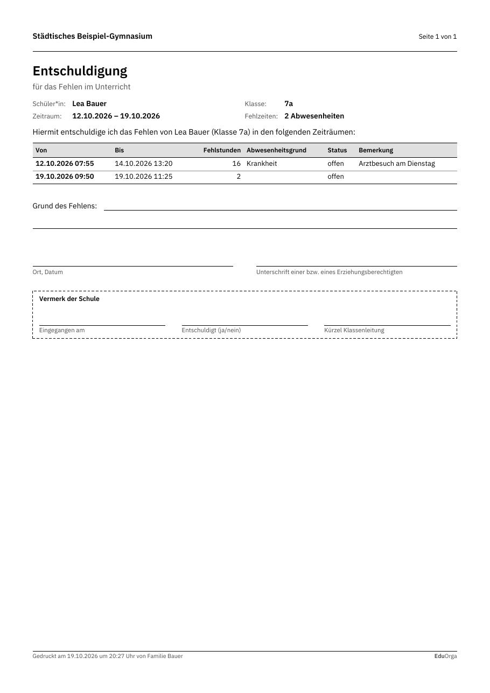
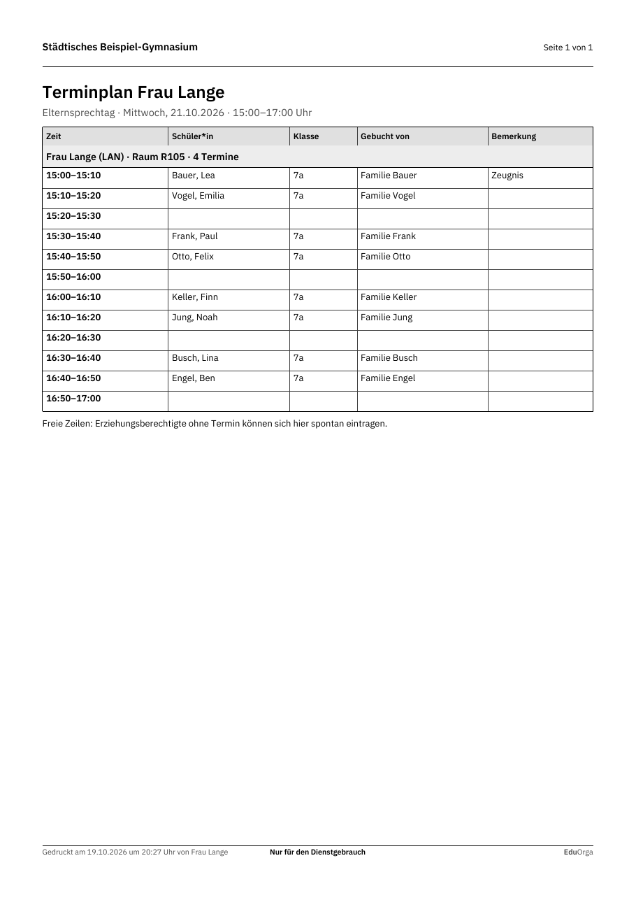
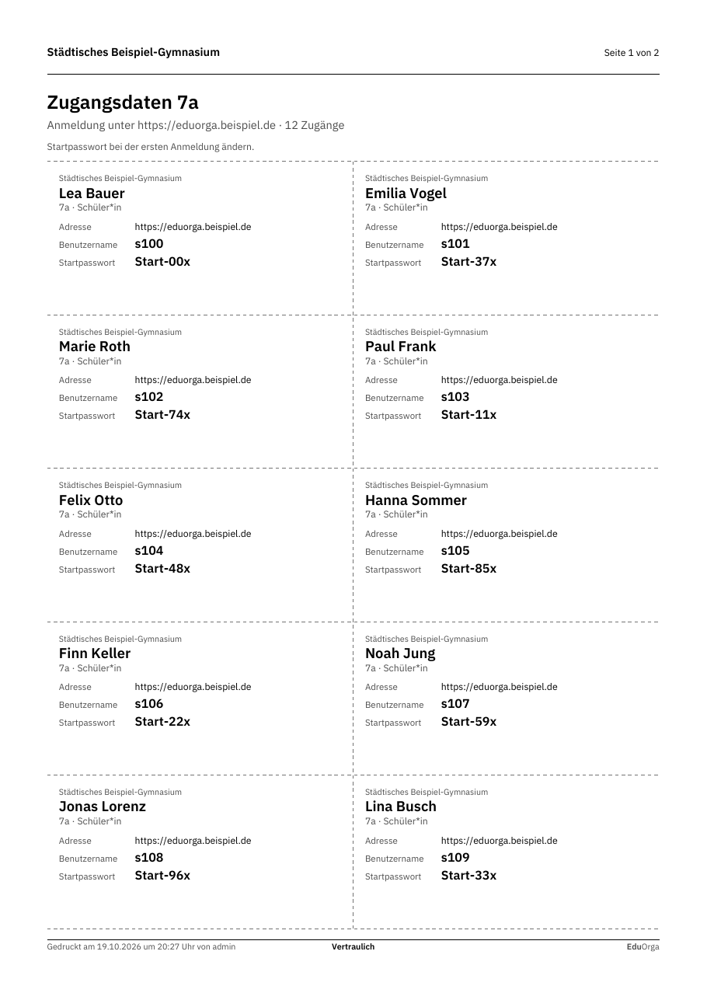

# UntPlan Studio – Benutzerhandbuch

UntPlan Studio ist die Anwendung für Stunden-, Kurs- und Vertretungsplanung. Sie läuft im Browser; alle Berechnungen
(Planung, Optimierung, Vertretungsvorschläge, Auswertungen) führt der Server aus. Mehrere Personen können gleichzeitig
an derselben Schuldatei arbeiten.

Das Handbuch folgt dem Arbeitsablauf einer Stundenplanerstellung: Schuldaten → Stammdaten → Unterricht → automatische
Planung → manuelles Planen → Stundenpläne → Vertretungsplanung → Auswertung und Ausgabe → Datenaustausch.
Bedienschritte sind in der Form *Bereich → Eintrag* angegeben, z. B. *Stammdaten → Lehrkräfte*. Jede Funktion lässt
sich außerdem über die Befehlssuche (**Strg+K**) aufrufen.

## Inhalt

1. [Erste Schritte](#1-erste-schritte)
2. [Schuldaten](#2-schuldaten)
3. [Stammdaten](#3-stammdaten)
4. [Unterricht](#4-unterricht)
5. [Automatische Planung](#5-automatische-planung)
6. [Manuelles Planen](#6-manuelles-planen)
7. [Stundenpläne](#7-stundenpläne)
8. [Vertretungsplanung](#8-vertretungsplanung)
9. [Auswertung und weitere Module](#9-auswertung-und-weitere-module)
10. [Ausgabe](#10-ausgabe)
11. [Datenaustausch und UntPlan Web](#11-datenaustausch-und-untplan-web)
12. [Mehrbenutzerbetrieb und Konten](#12-mehrbenutzerbetrieb-und-konten)
13. [Bedienung von Tabellen](#13-bedienung-von-tabellen)
14. [Tastenkürzel](#14-tastenkürzel)

---

## 1. Erste Schritte

### Anmelden

Öffnen Sie die Adresse Ihres Studio-Servers im Browser und melden Sie sich mit Benutzername und Passwort an. Die
Konten verwaltet die Administration (siehe [Abschnitt 12](#12-mehrbenutzerbetrieb-und-konten)).

### Oberfläche

| Element | Inhalt |
|---|---|
| Navigation | Bereiche der Planung, z. B. *Stammdaten*, *Unterricht*, *Planung*, *Stundenpläne*. Selten gebrauchte Einträge stehen unter „weitere“. |
| Kopfleiste | geöffnete Schuldatei, Umschalter *Stundenplanung / Vertretungsplanung*, in der Stundenplanung die **aktive Periode** (Name und Zeitraum, ‹ › wechselt zur vorherigen bzw. nächsten, Klick öffnet die Liste mit „Neue Periode ab …“), im Vertretungsmodus das Planungsdatum und „An Web senden“ (Symbol mit Statuspunkt: grün gesendet, gelb vorgemerkt, rot Fehler – Einzelheiten in der Kurzinfo), Rückgängig und Wiederholen, Speicherstand (in schmalen Fenstern nur als Symbol), Befehlssuche, Konto |
| Übersicht | Kennzahlen der Schuldatei (Klassen, Lehrkräfte, Räume, Fächer, Unterrichte, Planstunden), Planqualität mit Bewertungszahl und Schnellzugriff |

**Befehlssuche:** **Strg+K** (bzw. ⌘K) öffnet ein Suchfeld. Tippen Sie einen Teil des Namens, z. B. „zeitw“ oder
„drucken“; die Pfeiltasten wählen, Enter führt aus, Esc schließt. Gefunden werden alle Einträge der Navigation und
alle weiteren Befehle der Module.

### Schuldateien

Eine Schuldatei enthält alle Daten eines Schuljahres. Die Schuldateien liegen auf dem Server. Über das Menü der
Schuldatei in der Kopfleiste erreichen Sie:

- **Zuletzt verwendet** und **Alle Schuldateien …** – Datei öffnen.
- **Neue Schuldatei …** – *Leere Schuldatei* (Schulname und Schulform; Fächer und Zeitraster nach NRW-Vorgaben werden
  angelegt) oder *Beispielschule* (fiktives Gymnasium mit verplantem Stundenplan zum Ausprobieren).
- **Datei hochladen …** – eine Schuldatei (`.up`) oder eine BAL-Datei vom Rechner übernehmen.
- **Informationen**, **Speichern**, **Herunterladen (.up)**, **Schließen**.

**Speichern:** Geänderte Dateien speichert der Server automatisch nach kurzer Zeit. **Strg+S** speichert sofort. Die
Kopfleiste zeigt „Nicht gespeicherte Änderungen“ bzw. den Zeitpunkt der letzten Speicherung.
**Rückgängig:** Jede Änderung lässt sich mit **Strg+Z** rückgängig machen und mit **Strg+Y** wiederholen (50 Schritte).

### Stundenplanung und Vertretungsplanung

Studio arbeitet in zwei Modi, die Sie in der Kopfleiste oder mit **Strg+Umschalt+V** umschalten:

| Modus | Inhalt |
|---|---|
| Stundenplanung | Stammdaten, Unterricht, Planung, Optimierung, Stundenpläne, Oberstufe, Auswertung |
| Vertretungsplanung | Kalender, Abwesenheiten, Vertretungen, Vorschlag, Veranstaltungen, Bereitschaften, Pausenaufsichten, tagesaktuelle Pläne, Statistik |

Stammdaten, Stundenpläne, Ausgabe, Datenaustausch und Schule stehen in beiden Modi zur Verfügung.

**Auswahl wirkt auf alle Ansichten:** Wählen Sie eine Lehrkraft, eine Stunde oder eine Vertretung, folgen die
geöffneten Stundenpläne mit eingeschalteter **Fensterverknüpfung** (Kettensymbol) dieser Auswahl.

---

## 2. Schuldaten

### Schuldaten und Einstellungen

*Schule → Schuldaten* enthält mehrere Seiten:

- **Allgemein:** Schulbezeichnung, Zusatz/Ort, Adresse, Schulnummer (NRW: 6-stellig), Land, Region, Schulform;
  Schuljahr von/bis (die Sommerferien gehören nicht zum Schuljahr), **Wochenperiodizität** (1 = jede Woche gleich,
  2 = A/B-Wochen …) und Wochenbuchstabe der ersten Schulwoche.
- **Werte:** tagesgenaue Soll/Ist-Rechnung; Grenze, ab der Mehrarbeit vergütungsfähig ist (Standard: mehr als
  3 Stunden je Kalendermonat).
- **Vertretungsplanung:** Titel des Vertretungsplans, Entfall in Randstunden ab Jahrgang (Standard EF), Bereitschaften
  nur als Doppelstunden, Vertretungsgewichtung (siehe [Abschnitt 8](#vertretungsvorschlag)).
- **Diverses:** Unterrichtsänderungen in Folgeperioden übernehmen, Farbschema für den Druck.

Änderungen werden mit **Übernehmen** gespeichert.

### Ferien und Kalender

*Schule → Kalender und Ferien* zeigt links den **Jahreskalender** (die zwölf Monate des Schuljahres) und rechts die
**Liste** der freien Abschnitte. **Ferien und Feiertage NRW eintragen** übernimmt alle amtlichen Ferien und Feiertage.

- **Tage markieren:** im Kalender mit gedrückter Maustaste über die Tage ziehen (auch über Monatsgrenzen) – oder Tag
  anklicken und mit Umschalt+Klick erweitern. Die Leiste über dem Kalender nennt Zeitraum, Anzahl und vorhandene
  Einträge.
- **Als frei markieren …** (oder Doppelklick): Art wählen – *Ferien*, *Feiertag*, *Beweglicher Ferientag* oder
  *Unterrichtsfreier Tag* –, Namen vergeben (z. B. „Herbst“, „Pädagogischer Tag“) und übernehmen; Von/Bis lassen sich im
  Dialog noch mit dem Kalender ändern.
- **Wieder Schultag(e):** macht die markierten Tage wieder zu Unterrichtstagen; längere Einträge werden dabei gekürzt
  oder geteilt.
- **Liste:** Name, Von und Bis (Datumsfelder mit Kalender), Feiertag, *Woche danach* (A/B-Wochen) und *Wochen zählen*
  direkt ändern; die Bezeichnung steht klein unter dem Namen (Doppelklick ändert sie). Klick auf eine Zeile markiert den
  Zeitraum im Kalender, **Löschen** entfernt die markierten Einträge.
- Ferien und freie Tage sind blau, Feiertage kräftiger blau, Wochenenden grau; unten stehen die Kennzahlen des
  Schuljahres (Tage, Wochen, Ferientage). Jede Änderung lässt sich mit Strg+Z bzw. „Rückgängig“ im Hinweis zurücknehmen.

### Zeitraster

*Schule → Zeitraster*, Seite **Allgemein**:

- Anzahl Tage, maximale Stundenzahl pro Tag, letzte Vormittagsstunde, maximale Nachmittagsstunden, Länge einer
  Normalstunde, erster Schultag der Woche, Nummer der ersten Stunde.
- Beginn und Ende jeder Stunde.
- Belegung jeder Stunde: **Vormittag**, **Nachmittag** oder **leer** (z. B. Mittagspause). Zellen markieren (ziehen,
  Strg+Klick) und mit der Schaltfläche belegen.

Seite **Pausen:** Pausen mit Dauer. Ist **Pausenaufsicht** markiert, plant das Modul Pausenaufsichten diese Pause.
Außerdem die Mittagspause (von/bis Stunde) und die Zahl der Klassen, die höchstens gleichzeitig Mittagspause haben.

---

## 3. Stammdaten

Stammdaten sind die Grundelemente der Planung: *Stammdaten → Klassen, Lehrkräfte, Räume, Fächer, Schülerinnen und
Schüler*, unter „weitere“ außerdem Raumgruppen, Aufsichtsbereiche, Abteilungen, Abwesenheitsgründe und Kommentare.
Jede Liste ist eine bearbeitbare Tabelle (Bedienung siehe [Abschnitt 13](#13-bedienung-von-tabellen)).

- **Neues Element:** Kurzname in die letzte Zeile „Neu: …“ schreiben oder **Neu** wählen.
- **Löschen:** Entf bzw. **Löschen**. Wird das Element im Unterricht verwendet, nennt Studio die Zahl der betroffenen
  Unterrichte; die Verweise werden entfernt.
- **Spalten:** **Spalten** (oder Rechtsklick auf die Kopfzeile) blendet weitere Felder ein. **Anpassen** passt die
  Breiten an den Inhalt an.
- **Suchen:** Das Suchfeld filtert die Zeilen.
- **Unterricht** und **Stundenplan** öffnen Unterricht bzw. Plan des gewählten Elements.

Gemeinsame Felder aller Elemente: Name (Kurzname), Langname, Text, Beschreibung, Aliasname, Statistik-Kennzeichen,
Abteilung, **Fix (X)** (Unterricht des Elements wird von der Optimierung nicht verändert), **Ignore (i)** (Element wird
nicht verplant), Farbe.

**Farben** (Klassen, Lehrkräfte, Räume, Fächer, Abwesenheitsgründe): Die Spalte *Farbe* steht direkt neben dem Namen.

- **Klick auf das Farbfeld** öffnet die Palette: 24 ruhige Farben in drei Reihen (mittel, hell, gedeckt), **Keine
  Farbe** und eine eigene Farbe als Hex-Wert (z. B. `#3f7f9a`) oder über den Farbwähler. Pfeiltasten wählen, Enter
  übernimmt. Den Hex-Wert können Sie auch direkt in die Zelle tippen.
- **Mehrere auf einmal:** Zeilen markieren (Strg+Klick, Umschalt+Klick) und **Farben → Farbe zuweisen …** bzw. im
  Kontextmenü *Farbe zuweisen …* – oder auf das Farbfeld einer markierten Zeile klicken. **Farbe entfernen** leert sie.
- **Zufallsfarben:** **Farben → Zufallsfarben für … ohne Farbe** vergibt gut unterscheidbare Farben an alle Elemente
  ohne Farbe – sie heben sich auch von den schon vergebenen ab. **… für alle (ersetzen)** färbt alle neu (mit
  Rückfrage). Jede Farbänderung ist eine Rückgängig-Stufe; der Hinweis unten rechts hat dafür den Knopf **Rückgängig**.
- Im Stundenplan bestimmt die **Fachfarbe** die Farbe der Stunde (leichte Tönung, Balken links in der Farbe). Stunden ohne
  Fachfarbe erscheinen als neutrale hellgraue Karte mit grauem Balken links – in allen Plänen (Stundenplan, Blockansicht,
  Manuell planen, Gesamtübersichten, Tagespläne), hell wie dunkel.

### Räume

- **Ausweichraum:** Ist der gewünschte Raum belegt, wird der Ausweichraum verwendet. Mehrere Ausweichräume können einen
  **Ring** bilden (R101 → R102 → … → R101); die Optimierung nutzt dann jeden freien Raum des Rings.
- **Wanderklassen:** Klassen ohne festen Stammraum erhalten einen freien Raum aus einem Ausweichraum-Ring.
- **Raumgewicht 0–4:** 0 bedeutet, der Unterricht darf auch ohne Raum stattfinden; 4 bedeutet, der Raum ist
  unverzichtbar (z. B. Sporthalle).
- **Raumgruppen** (*Stammdaten → Raumgruppen*): gleichwertige Fachräume (EDV1, EDV2). Ist eine Raumgruppe als Fachraum
  angegeben, wählt die Optimierung einen freien Raum der Gruppe.
- Weitere Felder: Kapazität, Aufsichtsbereich (Gang), Stockwerk, Raumart, *buchbar (Web)* für Raumbuchungen in UntPlan
  Web.
- **Raum sperren:** in den Zeitwünschen des Raums den Wert **−3** eintragen.

### Klassen

Stammraum, Jahrgang, Stufe, Klassenlehrer, Hauptfächer pro Tag und hintereinander, Mittagspause (min.–max.),
Stunden pro Tag, max. Nachmittage, Schülerzahlen, Klassengruppe, Gültigkeit von/bis.
Die **Kernzeit** (Zeitwunsch +3) markiert Stunden, die unbedingt belegt sein sollen.

### Lehrkräfte

- **Werte:** Wochensoll, Ermäßigungen (Form `Grund:Wert; Grund:Wert`), Soll abzüglich Ermäßigungen, Ist, Wertkorrektur.
- **Unterricht:** Lehrbefähigung (Fächer), Hohlstunden min.–max., Stunden pro Tag, Mittagspause, max. Nachmittage,
  Stammraum.
- **Vertretungsplanung:** max. Vertretungen pro Woche/Monat, „Keine Vertretung“, Sperrvermerk (0–9, je höher, desto
  seltener wird die Lehrkraft vorgeschlagen), Bereitschaften max.
- **Pausenaufsicht:** Aufsichten min./max., maximale Aufsichtsminuten, „Keine Aufsicht“.
- **Allgemeine Daten:** E-Mail, Telefon, Personalnummer, Geburtsdatum, Geschlecht, Status.

### Fächer

Fachraum oder Raumgruppe, Hauptfach, Doppelstunden (min.–max.), **(M)** mehrmals pro Tag, **(R)** Randstunde,
**(N)** kein Nachmittag, Fachgruppe, Werte-Faktor, Farbe. Für die Vertretungsplanung: Entfall nicht zählen, keine
Vertretung, nicht drucken, keine Pausenaufsicht.

**Bereitschaft:** Ein Fach mit dem Merkmal **(B) Bereitschaft** (im NRW-Katalog: **BER**) ist kein echter Unterricht.

- Bereitschaftsstunden werden wie Unterricht verplant.
- In dieser Stunde steht die Lehrkraft für Vertretungen zur Verfügung und wird im Vertretungsvorschlag bevorzugt.
- Bereitschaftsvertretungen zählen **nicht** als Mehrarbeit.
- *Bereitsch. im Deputat* legt fest, ob die Bereitschaftsstunden auf das Deputat angerechnet werden.

### Abwesenheitsgründe

Je Grund: *Statistik* (zählt in der Statistik), *Vertraulich* (wird nie an UntPlan Web übertragen), *Entfall zählen*,
*Freisetzung nicht zählen*, *nicht im Kopf* (erscheint nicht im Kopf des Vertretungsplans), Farbe.

### Zeitwünsche

*Unterricht → Zeitwünsche*: Oben wählen Sie die Art (Klasse, Lehrkraft, Raum, Fach, Unterricht) und das Element;
die Pfeile blättern zum vorherigen bzw. nächsten Element. Elemente mit Zeitwünschen sind in der Auswahl mit einem Punkt
markiert.

| Wert | Bedeutung |
|---|---|
| −3 | keinesfalls Unterricht (absolute Sperrung) |
| −2 | eigentlich nicht |
| −1 | lieber nicht |
| 0 | kein Wunsch |
| +1 | eher ja |
| +2 | eigentlich schon |
| +3 | auf jeden Fall Unterricht (Kernzeit) |

Wählen Sie den Wert oben und überstreichen Sie die Stunden mit gedrückter Maustaste. Ein Klick auf **Tage**, **Vorm.**
oder **Nachm.** belegt den ganzen Tag bzw. Vor- oder Nachmittag. Die Tasten 3 2 1 0 und Umschalt+1 2 3 (= −1 −2 −3)
wählen den Wert.

Darunter stehen die **unbestimmten Zeitwünsche**, z. B. „1 Tag, Freihalten (−3)“: Die Lehrkraft möchte einen freien
Tag, gleich welchen. Bereiche: Tage, Vormittage, Nachmittage; Stärke −1 bis −3.

Zeitwünsche für einzelne Unterrichte: *Unterricht → Zeitwünsche je Unterricht* (unter „weitere“).

---

## 4. Unterricht

*Unterricht → Nach Klassen*, *Nach Lehrkräften*, *Nach Fächern* bzw. *Alle Unterrichte*.

- **Spalten:** U-Nr (wird automatisch vergeben), Kl,Le (Anzahl Klassen und Lehrkräfte einer Kopplung), Nvpl.Std. (nicht
  verplante Stunden), Wst (Wochenstunden), Jst (Jahresstunden), Fach, Lehrer, Klasse(n), Fachraum, Stammraum,
  Dopp.Std., Block, Text, Fix, Ignore. Weitere Spalten (Band, Kursname, Schülergruppe, Werte, Woche A/B,
  Unterrichtsgruppe, von/bis, Statistik …) blenden Sie über **Spalten** ein.
- **Neuer Unterricht:** in die letzte Zeile schreiben oder **Neu** wählen.
- **Raumvorschlag:** Beim Eintragen werden der Fachraum (aus dem Fach) und der Stammraum (aus der Klasse bzw.
  Lehrkraft) übernommen.

Unterrichtsformen:

- **Kopplung:** Mehrere Lehrkräfte und Klassen unterrichten gleichzeitig, z. B. Religion KR/ER/PP für 6a und 6b.
  **Kopplung** fügt eine Kopplungszeile hinzu; die Zeilen stehen unter dem Unterricht.
- **Doppelstunde:** Feld Dopp.Std. min–max, z. B. `1-1`.
- **Block:** z. B. `3` für Dreierblöcke.
- **Band:** Unterrichte mit gleichem Band (z. B. Kursschiene `EF-1`) werden immer parallel gelegt.
- **A/B-Woche, befristet von–bis, Werte-Faktor:** in den gleichnamigen Spalten.

Weitere Funktionen (Werkzeugleiste und Kontextmenü): Kopplungszeile löschen, Unterricht kopieren, Unterricht löschen,
Stundenplan des Elements öffnen.

**Unterrichtsgruppen (A/B-Wochen):** *Unterricht → Unterrichtsgruppen* (unter „weitere“) legt Gruppen wie *A-Woche*,
*B-Woche* oder *1. Halbjahr* mit Kalenderwochen bzw. Zeitraum und Unterbrechungen fest. Weisen Sie einem Unterricht
oder einer Kopplungszeile eine Gruppe zu. Zwei Stunden zur gleichen Zeit gelten nur dann als Kollision, wenn sich ihre
Wochen überschneiden; Raumbelegung und Wertrechnung rechnen anteilig.

**Stundentafel:** *Unterricht → Stundentafel* (unter „weitere“): Soll-Stunden je Jahrgang und Fach mit Abgleich
gegen den eingegebenen Unterricht.

---

## 5. Automatische Planung

### Gewichtung

*Planung → Gewichtung*: 26 Kriterien auf den Seiten Lehrer, Klassen, Fächer, Hauptfächer, Räume, Stundenverteilung und
Zeitwünsche. Jedes Kriterium hat ein Gewicht von 0 (unwichtig) bis 5 (extrem wichtig).

- *Gewichtungs-Verteilung* zeigt die Gewichte im Verhältnis zueinander.
- *Analyse* nennt die Kriterien, die mit den aktuellen Daten schwer zu erfüllen sind.
- *Voreinstellung* stellt die Standardgewichte wieder her.

Verwenden Sie die Stufen 4 und 5 sparsam.

### Diagnose

*Planung → Diagnose*: Die Seite **Eingabedaten** prüft vor der Optimierung, z. B. Lehrkräfte mit mehr Stunden als
verfügbaren Zeiten, Unterricht ohne Lehrkraft oder Raum und Soll-Ist-Differenzen.
Die Seite **Stundenplan** listet die Verstöße des aktuellen Plans mit Gewicht und Anzahl. Rechts stehen Beschreibung
und Einzelfälle; **Betroffenen Stundenplan anzeigen** (oder Doppelklick) öffnet den Plan des Falls.
Prüfen Sie vor den ersten Optimierungsläufen Ihre Eingabedaten mit der Diagnose.

### Optimierung

*Planung → Automatische Planung* öffnet die **Steuerdaten zur Optimierung**:

| Verfahren | Verwendung |
|---|---|
| Kompakt – ein schneller Durchlauf | erster Überblick; eignet sich zum Finden von Eingabefehlern |
| Gründlich – mehrere Durchläufe | Standard |
| Stufenweise – schnell | Unterricht wird schrittweise verplant |
| Stufenweise – gründlich | schrittweise mit mehreren Durchläufen |
| Langlauf – über Nacht | lange Laufzeit, viele Pläne |

Weitere Einstellungen:

- Anzahl Pläne je Serie (1–20) und Optimierungsschritte je Plan (1–9).
- Start- und Erhöhungs-Prozentsatz (nur für die stufenweisen Verfahren).
- Ähnlichkeit zum Vorplan (0 = nicht ähnlich … 4 = sehr ähnlich).
- **Plan bedingt fixieren:** Vorhandene Stunden werden nur verlegt, wenn es nicht anders geht.
- Lehrkräfte nur gewünschte freie Tage, Doppelstunden besonders optimieren, nur nicht verplante Stunden setzen.
- Unterricht ohne Lehrkraft vorher automatisch zuordnen.

Die Optimierung läuft auf dem Server im Hintergrund; Sie können währenddessen weiterarbeiten. Die Ansicht
*Optimierung* zeigt Fortschritt und Dauer; **Abbrechen** beendet den Lauf.

Nach dem Lauf erscheinen der aktuelle Plan und alle neuen Pläne mit **Bewertungszahl** und Kennzahlen (nicht verplante
Stunden, Hohlstunden, Kernzeitverletzungen, Fach zweimal am Tag, Doppelstundenfehler, Zeitwunschverletzungen,
Lehrer-Hohlstunden, kein Raum, Kollisionen, Abweichungen zum aktuellen Plan). Kleiner ist besser; grüne Werte sind
besser als im aktuellen Plan. Der beste Plan ist vorausgewählt. **Vergleich** zeigt aktuellen und gewählten Plan
nebeneinander, **Plan übernehmen** (oder Doppelklick) übernimmt ihn, **Verwerfen** löscht die Ergebnisse.
Fixierte Stunden bleiben immer unverändert. Wurde das Dokument seit dem Start geändert, weist Studio darauf hin: Beim
Übernehmen gehen diese Stundenplanänderungen verloren.

Zur Mittagspause: Mit *fix* ist eine Stunde immer frei. Mit *flexibel* bleibt innerhalb des Bereichs (z. B.
6.–7. Stunde) mindestens eine Stunde frei.

---

## 6. Manuelles Planen

*Planung → Manuell planen* öffnet den Stundenplan einer Klasse mit eingeschaltetem **Planen**. Nicht verplante Stunden
stehen unter dem Plan (z. B. „2× D 5a“, Blöcke mit Länge).

### Verplanen, Verschieben, Tauschen

Ziehen Sie eine nicht verplante Stunde oder eine Stunde des Plans auf ein Feld. Während des Ziehens sind die Felder
eingefärbt:

| Farbe | Bedeutung |
|---|---|
| grün | Verplanung ohne Kollision möglich |
| rot | kollisionsfrei, aber Vorgabe verletzt (Sperrung, negativer Zeitwunsch) |
| violett | kollisionsfrei, aber kein passender Raum frei |
| Rahmen | Tausch möglich |
| ohne Farbe | Kollision |

Kommt es zu einer Kollision, fragt Studio, ob der **behindernde Unterricht entplant** werden soll (Ja: er erscheint unter
„nicht verplant“; Nein: trotzdem ausführen, die Kollision bleibt bestehen).

- **Markieren:** Klick wählt eine Stunde, Strg+Klick weitere; **Strg+A** markiert alle, **Esc** hebt die Markierung auf.
- **Fixieren** (**F**): Die Stunde wird von der Optimierung nicht verändert.
- **Entplanen** (**Entf**): Die Stunde wandert zurück zu den nicht verplanten Stunden.
- **Tauschvorschläge:** Für die markierte Stunde zeigt Studio alle Tausche ohne neue Kollisionen, sortiert nach
  **Gewinn** (Verbesserung der Bewertungszahl). **Tauschen** führt den gewählten Tausch aus.
- Das Kontextmenü (rechte Maustaste) bietet außerdem: ganzen Block bzw. alle Stunden des Unterrichts markieren,
  Unterricht bearbeiten, Zeitwünsche des Unterrichts.
- *Planung → Fixierungen* fixiert alle Stunden bzw. hebt alle Fixierungen auf; *Planung → Alle Stunden entplanen*
  leert den Plan (beide unter „weitere“).

### Raumzuordnung

*Raum zuordnen / löschen* (Kontextmenü einer Stunde oder *Planung → Räume zuordnen*) zeigt links die Kopplungszeilen
des Unterrichts und rechts alle Räume.

**Anwenden auf:** die Unterrichtsstunde, den Stundenblock oder alle Stunden des Unterrichts.

| Spalte | Bedeutung |
|---|---|
| Kap. | Kapazität des Raums |
| Ausw.-Rm. | Ausweichraum des Wunschraums |
| Stammr. | Stammraum einer beteiligten Klasse |
| Besetzt / Besetzt durch | belegt durch anderen Unterricht; A/B-Wochen werden beachtet |
| Raumgruppe, Gang | Zuordnung des Raums |
| Wo.-Bel. | Belegung des Raums in der Woche |
| Std.frei | in wie vielen der betroffenen Stunden der Raum frei ist |
| Kap.Diff. | Kapazität minus Schülerzahl der Klassen |

Wunschräume bzw. Räume der Raumgruppe, besetzte und gesperrte Räume sind farblich unterschieden.
**Filter:** nur freie Räume, nur Wunschräume/Raumgruppe, nur ausreichende Kapazität, Suchfeld, Langname anzeigen.
**Bedienung:** Doppelklick, Enter oder ← ordnet den Raum zu; das Löschsymbol bzw. Entf entfernt ihn.

Ist der gewählte Raum belegt, haben Sie drei Möglichkeiten:

- **Behindernden Unterricht aus dem Raum verdrängen.**
- **Räume tauschen.**
- **Kollision zulassen.**

In der **Gesamtübersicht Räume** verlegen Sie Räume per Drag & Drop in eine andere Raumzeile.

---

## 7. Stundenpläne

*Stundenpläne → Klassen, Lehrkräfte, Räume, Fächer*.

- **Element wählen:** Auswahl oben; die Pfeile wechseln zum vorherigen bzw. nächsten Element.
- **Einzelplan / Blockansicht:** Der Umschalter links in der Werkzeugleiste jedes Stundenplans (auch in *Manuell planen*;
  dort öffnet er die Blockansicht als eigene Seite), *Stundenpläne → Blockansicht* in der Navigation und **Blockansicht**
  in den Gesamtübersichten. Die Blockansicht zeigt statt eines Plans **mehrere Pläne als
  Kacheln** neben- und untereinander (z. B. alle Klassen eines Jahrgangs oder alle Lehrkräfte einer Abteilung) – mit
  dichten Feldern, Doppel- und Blockstunden als ein Feld, Kopplungen nebeneinander; Stunden nach der letzten belegten
  Stunde werden weggelassen. Die Pläne wählen Sie in der durchsuchbaren Liste (Mehrfachauswahl) oder über
  **Schnellauswahl** (alle bzw. je Jahrgang, Abteilung oder Raumart); **Anordnung** legt fest, wie viele Kacheln in einer
  Zeile stehen. Klick auf den Kopf einer Kachel (oder Doppelklick auf eine Stunde) öffnet den Einzelplan. **Drucken** gibt
  die gezeigten Pläne im Querformat aus (drei je Zeile, Kacheln werden nicht getrennt).
- **Blöcke:** Doppelstunden und Blöcke erscheinen als ein Feld. Gekoppelte und gleichzeitige Stunden stehen
  nebeneinander.
- **Fensterverknüpfung:** Ein Klick auf eine Stunde, z. B. im Lehrerplan, stellt die verknüpften Klassen- und Raumpläne
  auf die Klasse bzw. den Raum dieser Stunde um.
- **Planen:** schaltet das Verschieben per Drag & Drop ein oder aus (siehe [Abschnitt 6](#6-manuelles-planen)).
- **Kompakte Darstellung:** kleinere Pläne, die ohne Blättern auf den Bildschirm passen; *Stundenpläne → Kompaktpläne*
  (unter „weitere“).
- **Doppelklick** auf eine Stunde öffnet den Unterricht.
- **Gesamtübersichten:** *Stundenpläne → Gesamtübersicht Klassen / Lehrkräfte / Räume*: alle Elemente als Zeilen, Tage
  × Stunden als Spalten. Stunden lassen sich innerhalb der Zeile verschieben oder tauschen. Drucken bzw. als PDF
  herunterladen.
- **Planformate:** *Stundenpläne → Planformate* (unter „weitere“): eigene Formate als Kopie einer Vorlage anlegen,
  bearbeiten und löschen – Schriftgröße, Farben, Zeitanzeige, Layout, HTML-Ausgabe und die Felder einer Stunde (mit
  grafischem Editor). **Probedruck** zeigt das Ergebnis. Die Formate liegen in der Schuldatei und werden beim Drucken
  gewählt.

Ausgabe der Pläne siehe [Abschnitt 10](#10-ausgabe).

---

## 8. Vertretungsplanung

Schalten Sie in den Modus **Vertretungsplanung**. Das **Planungsdatum** steht in der Kopfleiste; die Pfeile bzw.
**Strg+Bild↑ / Strg+Bild↓** blättern zum vorherigen bzw. nächsten Unterrichtstag, die Doppelpfeile um eine Woche.
Mit dem Datum wechselt automatisch die gültige Periode.

### Tagesplanung

*Vertretungsplanung → Tagesplanung* ist der Arbeitsplatz für den Planungstag. Standard ist die **Tagesübersicht nach
Klassen**: auf einen Blick, was heute in jeder Klasse passiert, und offene Stunden direkt dort lösen. Das Datum blättern Sie wie überall in der Kopfleiste (**Strg+Bild↑ / Strg+Bild↓**, eine Woche mit
**Strg+Umschalt+Bild↑ / Strg+Umschalt+Bild↓**). Auf Bildschirmen unter 1440 px Breite (z. B. MacBook 13") klappt die
Seitenleiste auf dieser Seite von selbst ein; der Menüknopf oben links bzw. **Strg+B** zeigt sie wieder.

**Kopf (eine Zeile):** Tag und Wochentyp, die Zahl der offenen Stunden (rot), Entfälle und Kollisionen; rechts

- **Klassen | Lehrkräfte | Offene Stunden | Tabelle** – die Tagesübersicht nach Klassen (Standard) bzw. Lehrkräften, die
  Liste der offenen Stunden mit Entscheidung oder die dichte Tabelle (siehe unten; die Wahl wird je Benutzer gemerkt),
- **Miniplan** (in der Tagesübersicht, P) – ein kleiner, frei verschiebbarer Plan der Lehrkraft (bzw. in der
  Lehrkräfteübersicht der Klasse) der gewählten Stunde, der der Auswahl folgt; **Pläne** (in *Offene Stunden* und
  *Tabelle*, P) blendet rechts die Tagespläne von Klasse und Lehrkraft, *Wer ist frei?* und *Alle Kandidaten* ein,
- **Abwesenheiten** (mit Anzahl) – öffnet das Blatt zum Erfassen (auch Taste **N**),
- **Veröffentlichen** – öffnet das Blatt *Prüfen und veröffentlichen*; daneben der Stand der letzten Übertragung an
  EduOrga Web („Gesendet · 10:42“, auf schmalen Bildschirmen in der Kurzinfo),
- **…** – Wer ist frei?, Alle Kandidaten, *Ganze Woche* (Tabelle und Pläne zeigen die Woche, dazu der Wochenstreifen
  mit den offenen Stunden je Tag), *Blöcke gemeinsam besetzen*, Alle Abwesenheiten (Strg+M), Kalender und Tagestexte,
  Belastung, Automatische Vertretung und Einstellungen.

**Änderungen aus EduOrga Web:** Beim Öffnen der Tagesplanung fragt Studio, wenn EduOrga Web verbunden ist und noch nicht
bearbeitete Rückmeldungen oder Stundenplanänderungen vorliegen: „Wollen Sie folgende Änderungen aus EduOrga Web
übernehmen?“ mit der Liste. **Ja** übernimmt sie, **Nein** markiert sie nach einer Warnung als ignoriert (sie werden
nicht erneut angeboten), **Später** fragt beim nächsten Öffnen wieder. Liegt nichts vor, erscheint keine Frage.

**Tagesübersicht nach Klassen (Standard).** Zeilen sind die Klassen, nach Jahrgang gegliedert (Klick auf die Kopfzeile
klappt einen Jahrgang ein, gemerkt), Spalten die Stunden des Tages. Kopf und Klassenspalte bleiben beim Blättern stehen;
auch große Schulen mit 70 und mehr Klassen bleiben flüssig. Jede Zelle zeigt die Stunde kompakt – Fach und Raum oben,
Lehrkraft darunter – und ihren Stand:

| Darstellung | Bedeutung |
|---|---|
| ruhige graue Kachel | regulärer Unterricht |
| rote Linie, bisherige Lehrkraft durchgestrichen, rotes „?“ | offen – Vertretung fehlt (gestrichelt: nur der Raum fehlt) |
| Linie in der Änderungsfarbe, neue Lehrkraft in der Änderungsfarbe, bisherige durchgestrichen | vertreten bzw. zusammengelegt |
| Raum in der Änderungsfarbe | Raumänderung |
| gestrichelt in der Änderungsfarbe, „ohne“ | ohne Lehrkraft (Aufgaben, EVA) |
| schraffiert, Fach rot durchgestrichen | Entfall |
| Linie in der Änderungsfarbe | zusätzlich bzw. verlegt |
| gestrichelte Linie in der Terminfarbe | Termin; ein Band über mehrere Stunden: Klasse abwesend (Ausflug, Praktikum …) mit Text |
| bernsteinfarbene Linie | Klausur |

Doppel- und Blockstunden stehen als eine Zelle; mehrere gleichzeitige Stunden (Kurse) zeigen „+2“, die Kurzinfo bzw. die
Entscheidung listet alle. Im **Spaltenkopf** jeder Stunde stehen die offenen Stunden und die verfügbaren Lehrkräfte
(„4 offen · 2 frei“ – Bereitschaft, freigesetzt, Hohlstunde; ist mehr offen als frei, ist die Zahl bernsteinfarben; die
Kurzinfo nennt die Kürzel, ein Klick öffnet *Wer ist frei?*), darunter die Zeile **Bereitschaft** mit den
Bereitschaften bzw. Präsenzlehrkräften des Tages (eingesetzt durchgestrichen, abwesend rot). Über der Matrix: Suche
(Klasse, Lehrkraft, Fach), *Alle Jahrgänge*, **Nur Änderungen** (nur Klassen mit offenen, vertretenen oder entfallenen
Stunden bzw. Abwesenheit), die Zahlen des Tages („19 offen · in 17 Klassen · 8 Entfälle · 2 abwesend“; offene Aufsichten
ohne Klasse als Verweis auf *Offene Stunden*), *Legende*, *Alle prüfen …* (Empfehlungen für alle prüfen, A) und die Tasten.

Ein Klick auf eine Zelle wählt sie, rechts erscheint die **Entscheidung** (wie unten bei *Offene Stunden*: Empfehlung mit
Enter, Alternativen 2 und 3, Entfall, Zusammenlegen, weitere Möglichkeiten), darüber Verweise auf die Pläne von Klasse,
Lehrkraft und Raum als Miniplan. Nach jeder Entscheidung ist die nächste offene Stunde gewählt – Stunde für Stunde, also in
der Reihenfolge der Dringlichkeit. Für eine reguläre Stunde zeigt die Seite *Entfall* und *… ab hier abwesend*, für ein
Abwesenheitsband *Abwesenheit entfernen*. **Mehrere Stunden:** Strg+Klick, Umschalt+Klick (Rechteck), Umschalt+Pfeil oder
mit gedrückter Maustaste über offene Zellen ziehen – rechts stehen dann die gemeinsamen Kandidaten.

**Rechtsklick auf eine Zelle:** Plan von Klasse, Lehrkraft(en) und Raum als Miniplan, Entfall (bzw. *Stunde entfallen
lassen*), *Änderung zurücknehmen*, **Klasse … ab der 3. Stunde abwesend (Ausflug …)** (ab/bis Stunde, Grund, Text – die
Stunden der Klasse werden freigesetzt, die Lehrkräfte stehen für Vertretungen bereit), **… ab der 3. Stunde abwesend
melden** bzw. *ganztägig abwesend melden* für die Lehrkraft der Stunde, *Abwesenheit entfernen*. **Rechtsklick auf eine
Klasse:** Plan, *ganztägig abwesend (Ausflug …)*, Abwesenheit entfernen; Doppelklick öffnet den Miniplan.

| Taste (Tagesübersicht) | Wirkung |
|---|---|
| ← → ↑ ↓ | Zelle wählen (Umschalt: Mehrfachauswahl erweitern) |
| J / K | nächste / vorherige offene Stunde |
| Enter bzw. 1, 2 3 | Empfehlung bzw. Alternative übernehmen |
| E, B, O, R, M | Entfall (auch für eine reguläre Stunde), Zusammenlegen, ohne Lehrkraft, Raum, weitere Möglichkeiten |
| Entf | Änderung zurücknehmen |
| P | Miniplan, der der Auswahl folgt, ein-/ausblenden |
| V, F | Alle Kandidaten, Wer ist frei? |
| A, N | Empfehlungen für alle prüfen, Abwesenheit erfassen |
| Esc | Mehrfachauswahl aufheben |

**Tagesübersicht nach Lehrkräften.** Dieselbe Matrix mit den Lehrkräften als Zeilen: zuerst die abwesenden (Gruppe
*Abwesend*, Zeitraum schraffiert), dann alle anderen. Die Zellen zeigen Fach, Raum und Klasse; eine vertretene Stunde der
abwesenden Lehrkraft „6ab → MEY“, offene Stunden mit „?“, Bereitschaften als ruhige Kachel. Rechtsklick auf eine Lehrkraft:
ganztägig bzw. stundenweise abwesend melden.

**Miniplan.** Kleine Fenster mit dem tagesaktuellen Plan einer Klasse, Lehrkraft oder eines Raums über der Tagesplanung –
zu öffnen mit *Miniplan* bzw. P (folgt der Auswahl), über das Kontextmenü einer Zelle („Plan von 5a anzeigen“), mit
Rechtsklick auf einen Kandidaten der Entscheidung („Plan von SRO anzeigen“) oder mit Doppelklick. Mehrere Fenster
gleichzeitig; am Titel verschieben (an den Bildschirmrändern schnappen sie ein), an der Ecke unten rechts die Größe ändern,
*Tag | Woche* umschalten, mit der Nadel *folgt der Auswahl* an- bzw. abschalten, mit dem Pfeil (oder Doppelklick auf den
Titel) auf die Titelzeile einklappen, mit × schließen. Lage, Größe und Zustand werden je Benutzer im Browser gemerkt;
ein Klick auf eine geänderte Stunde im Miniplan wählt sie in der Tagesübersicht. Neue Fenster öffnen unten rechts über
der Matrix, damit die Entscheidung frei bleibt; auch auf einem 13-Zoll-Bildschirm (1280×720) bleibt die Seite ohne
waagrechtes Blättern.

**Offene Stunden.** Links stehen die offenen Stunden des Tages, nach Stunden gegliedert („2. Stunde 08:45–09:30 · 4“),
eine Zeile je Stunde: Klasse · Fach · fehlende Lehrkraft (durchgestrichen), rechts ggf. *Klausur* (Aufsicht), *Raum*
(nur der Raum fehlt) oder der Block („2.–3.“). Reiter **Offen** und **Gelöst** mit Anzahl. Rechts steht die
**Entscheidung** zur gewählten Stunde:

- oben, was fehlt: Stunde und Zeit, Klasse und Fach, *fehlt: KOC*, Raum, Grund, Block, „3 von 16“;
- **Empfehlung** – die beste Lehrkraft als ein Knopf („SRO übernehmen“, **Enter**) mit Begründung (schließt an,
  Hohlstunde, Bereitschaft, freigesetzt, kennt Klasse, Klassenlehrer, Fach …). Fehlt nur der Raum, ist es der beste freie
  Raum; ist keine Lehrkraft frei, der Entfall (Randstunde) bzw. das Zusammenlegen;
- **Alternativen** – die nächsten beiden Lehrkräfte als schlichte Zeilen (**2**, **3**); die Belastung (Vertretungen in
  Woche und Monat, Mehrarbeit nach NRW) zeigt die Zeile beim Überfahren bzw. ihre Kurzinfo. *Alle Kandidaten* öffnet den
  vollständigen Vorschlag (V);
- **Andere Lösung** – **Entfall** (E), **Zusammenlegen** mit einer Lehrkraft, die nebenher betreut (B), und
  **Weitere Möglichkeiten** (M): Ohne Lehrkraft (O), Raum zuordnen (R), Vorziehen, Verlegen oder tauschen (Pläne, Drag &
  Drop), Als Vormerkung beiseitelegen, Alle Kandidaten, Wer ist frei?, In der Tabelle bearbeiten.

Nach jeder Entscheidung ist die nächste offene Stunde gewählt; über der Entscheidung steht „Zuletzt: 2. Std. 7a M: SRO
eingetragen“ mit **Rückgängig** (wie Strg+Z). Für eine gelöste Stunde zeigt die Entscheidung das Ergebnis mit
*Zurücksetzen* (Entf) und *Andere Lehrkraft*.

| Taste | Wirkung |
|---|---|
| Enter bzw. 1 | Empfehlung übernehmen |
| 2 3 | Alternative übernehmen |
| J / K, ↓ / ↑ | nächste / vorherige Stunde |
| E, B, O, R | Entfall, Zusammenlegen, ohne Lehrkraft, Raum |
| M | Weitere Möglichkeiten |
| V, F, P | Alle Kandidaten, Wer ist frei?, Pläne ein-/ausblenden |
| A | Empfehlungen für alle prüfen |
| N | Abwesenheit erfassen |
| Entf | (Gelöst) Stunde zurücksetzen |
| Esc | Mehrfachauswahl aufheben bzw. Blatt schließen |

- **Große Schulen:** Die Liste (wie die Tagesübersicht) ist virtualisiert und lädt Kandidaten nur für die gewählte und die nächsten Stunden – auch
  mit 200 Lehrkräften und 150 offenen Stunden am Tag bleibt sie flüssig. Bei mehr als acht Stunden erscheint über der Liste
  eine Suche (Klasse, Fach, Lehrkraft) und **Filter** (Stunde, Jahrgang, Abteilung).
- **Empfehlungen für alle prüfen** (unter der Liste, Taste A) rechnet die automatische Vertretung (bester Vorschlag,
  sonst Entfall in Randstunden) zunächst nur zur Probe und zeigt die Vorschläge rechts zur Prüfung: jeder mit Begründung
  und Häkchen, **Alle übernehmen** bzw. **Auswahl übernehmen** oder einzeln *Übernehmen*; *Verwerfen* ändert nichts. Ist
  die Liste gefiltert (z. B. nur Jahrgang 5), sind zunächst nur deren Vorschläge gewählt. Die Übernahme ist eine
  Rückgängig-Stufe.
- **Mehrere Stunden auf einmal:** Mit gedrückter Maustaste über mehrere Zeilen ziehen (oder Strg+Klick, Umschalt+Klick)
  markiert sie. Rechts erscheinen die **gemeinsamen Kandidaten** – Lehrkräfte, die in allen markierten Stunden frei
  sind –; ein Klick (bzw. Enter, 1–3) trägt die Lehrkraft für alle ein. Entfall, Zusammenlegen, ohne Lehrkraft und Raum
  gelten ebenfalls für alle; Esc hebt die Auswahl auf.
- **Blöcke gemeinsam** (Menü …): Doppel- und Blockstunden werden zusammen besetzt (die Kandidaten sind in allen Stunden
  frei).
- **Pläne** (P) blendet rechts einen Bereich mit drei Reitern ein, der der gewählten Stunde folgt: **Pläne** von Klasse
  und Lehrkraft (Umschalter Tag | Woche, Vergrößern, Verlegen und Tauschen per Drag & Drop), **Wer ist frei?** – alle
  Lehrkräfte × Stunden des Tages (Unterricht, vertritt, Bereitschaft, freigesetzt, Hohlstunde, abwesend) mit
  Vertretungen in Woche und Monat; die Spalte der gewählten Stunde ist hervorgehoben, ein Doppelklick auf eine freie
  Zelle dort weist die Lehrkraft zu – und **Alle Kandidaten** (vollständiger Vertretungsvorschlag mit Betreuungen,
  Räumen, Vorziehungen). Das × bzw. P blendet den Bereich wieder aus; die Wahl wird je Benutzer gemerkt.

**Blatt „Abwesenheiten“** (Kopf *Abwesenheiten* bzw. N): Schnellerfassung – Art (Lehrkraft, Klasse, Raum), eine oder
**mehrere** Lehrkräfte auf einmal (Kürzel oder Name tippen), *Ganztägig* oder *Stunden* (ab/bis Stunde), bis
einschließlich (mehrtägig), Grund und Text; **Enter** speichert. Die offenen Stunden entstehen sofort; darunter steht,
welche Stunden je Lehrkraft daraus entstanden sind, und **… offene Stunden lösen** schließt das Blatt. Ist EduOrga Web
verbunden, holt *Abwesenheiten abrufen* Krankmeldungen aus dem Portal. Unten die vollständige Liste der Abwesenheiten
des Tages (direkt bearbeiten, teilen, übertragen, löschen).

**Blatt „Veröffentlichen“:** *Stand des Tages* (offene Stunden, Stunden ohne Raum, doppelt eingeplante Lehrkräfte,
doppelt belegte Räume – jeweils mit Einzelheiten), **Veröffentlichen** (*An EduOrga Web senden* mit Stand der letzten
Übertragung, Drucken Klassen- bzw. Lehrerversion als PDF, Monitor, Seitenlayout), *Zahlen des Tages* (Vertretungen,
Zusammenlegungen, Pausenaufsichten, Entfälle, ohne Lehrkraft, Raumänderungen, Verlegungen, Freisetzungen), *Nachrichten
zum Tag* (Tagestext hinzufügen bzw. entfernen), die *Notiz* des Vertretungsplaners und darunter die **Belastung der
Lehrkräfte** (Vertretungen heute, in der Woche und im Monat als Balken mit Höchstwert, Mehrarbeit nach NRW-Regel).
*Wer ist frei?* und *Belastung der Lehrkräfte* gibt es auch als eigene Seiten (Befehlssuche).

**Tabelle.** Für alle, die lieber in einer Tabelle arbeiten (ersetzt die frühere Expertenansicht): links die
Vertretungen des Tages (bzw. mit *Ganze Woche* der Woche), rechts dieselbe **Entscheidung** zur gewählten Zeile.

- **Vertretungen:** Std., Klasse, Fach, Lehrkraft, Vertretung, Raum und Art; offene Stunden stehen als rotes Wort
  *offen* in der Spalte. Direkte Eingabe in *Vertretung*, *Raum*, *Fach* und *Text* für die bearbeitete bzw. alle
  markierten Zeilen – die Auswahlliste der Spalte *Vertretung* nennt bei offenen Stunden zuerst die **besten Kandidaten**
  des Vorschlags in ihrer Reihenfolge mit Begründung („Vorschlag 1: schließt an · kennt Klasse“), danach alle
  Lehrkräfte (frei grün, belegt rot). Sichtbar sind *Vorschlag* (öffnet *Alle Kandidaten*), *Nächste offene* (F3),
  *Entfall* (-) und *Ohne Lehrkraft* (+); **Filter** enthält *Nur offene*, *Nur Kollisionen*, *Veranstaltungen
  zusammenfassen*, Ansicht, Klasse bzw. Lehrkraft und Zeitraum; im Menü **…** stehen Zurücksetzen (Entf), Raum
  zuordnen, Teilen, Vormerken, Fixieren, Nicht drucken, Automatische Vertretung, Neu berechnen, Löschen und die
  Darstellung (auf Wunsch alle Spalten der Listenansicht). Mehrere Zeilen mit der Maus aufziehen: die Entscheidung zeigt
  dann die gemeinsamen Kandidaten, das Kontextmenü *Vertretung zuweisen* ebenso. Die Tasten der Entscheidung (Enter, 1–3,
  E, B, O, R, M) gelten, wenn der Fokus in der Entscheidung liegt; in der Tabelle gelten deren Tasten.
- **Ganze Woche:** Die Tabelle zeigt die ganze Woche, gegliedert durch Tageszeilen wie „Mo 02.11.“ mit der Zahl der
  offenen Vertretungen; der Planungstag ist markiert. Ein Klick auf eine Tageszeile, eine Vertretung eines anderen Tages
  oder einen Tag im **Wochenstreifen** des Kopfs macht diesen Tag zum Planungstag.
- **Pläne** der Klasse und der Lehrkraft der gewählten Vertretung, Verlegen und Tauschen per Drag & Drop wie in den
  Tagesplänen. Jeder Plan hat im Kopf den Umschalter **Tag | Woche** (je Benutzer im Browser gemerkt; *Ganze Woche*
  stellt beide Pläne und die Tabelle gemeinsam um). In der Wochenansicht ist der Planungstag mit einer Linie in der
  Markenfarbe und einer hellen Fläche hervorgehoben, die Spaltenköpfe zeigen die offenen Stunden je Tag. Ein Klick auf
  eine Stunde oder den Kopf eines anderen Tages wechselt dorthin (Kopf, Liste und Entscheidung folgen; eine offene
  Stunde wird als Vertretung gewählt). Ein Klick auf eine Stunde im Klassenplan zeigt im anderen Plan deren Lehrkraft,
  ein Klick im Lehrkräfteplan die Klasse; die Wahl einer Vertretung stellt beide Pläne ein.
- **Aufteilung:** Zeigt ein Plan die Woche, stehen die beiden Pläne untereinander in einer breiteren rechten Spalte.
  Auf niedrigen Bildschirmen (etwa 1366×768) werden die Stunden einzeilig (Fach und Raum, Einzelheiten im Tooltip),
  damit die ganze Woche sichtbar bleibt. **Vergrößern** (⤢ im Plankopf) zeigt einen Plan über die ganze Fläche; Esc
  oder der Knopf stellen die Aufteilung wieder her. Alle Trenner lassen sich verschieben (gemerkt).

### Kalender und Nachrichten zum Tag

*Vertretungsplanung → Kalender*: Wochenübersicht mit Wochentyp und je Tag offene Vertretungen, abwesende Klassen,
Freisetzungen, blockierte Räume, Raumvertretungen, Tagestexte sowie Kollisionen von Lehrkräften und Räumen.

- **Tagestexte** (Nachrichten zum Tag): Text, gültig bis, Anzeige in UntPlan Web, Art (für alle oder nur für
  Lehrkräfte) und betroffene Elemente.
- **Kalendertag:** normaler Schultag, Feiertag, unterrichtsfrei (mit Grund) oder nur bestimmte Stunden unterrichtsfrei,
  dazu eine Notiz des Vertretungsplaners (wird nicht gedruckt).

### Abwesenheiten

*Vertretungsplanung → Abwesenheiten* (**Strg+M**): Lehrer-, Klassen- und Raumabwesenheiten mit Von/ab Stunde,
Bis/bis Stunde, Grund und Text.

- **Direkteingabe:** In der letzten Zeile „Neue Abwesenheit …“ tippen Sie Element, Datum und Stunden direkt ein.
  Datumsfelder akzeptieren z. B. `14.10.`. **Neu** öffnet stattdessen einen Dialog.
- **Klassenabwesenheit:** Begleitlehrer gelten ebenfalls als abwesend. Der Unterricht der Klasse wird zur
  **Freisetzung**; die freigesetzten Lehrkräfte stehen für Vertretungen zur Verfügung (Minusstunden).
- Mit dem Speichern erzeugt Studio sofort die **offenen Vertretungen**. Die Spalte *offen* zeigt ihre Zahl.
- **Hinweis bei geplanten Vertretern:** Wird eine Lehrkraft abwesend, die bereits als Vertreter eingeteilt ist, meldet
  Studio die betroffenen Vertretungen. Diese werden wieder offen.
- **Teilen**, **Kopieren** (für weitere Elemente) und **Zusammenfassen** bearbeiten Abwesenheiten; **Strg+Entf** löscht.

### Vertretungen

*Vertretungsplanung → Vertretungen* (**Strg+T**).

**Kopfbereich:**

- **Klasse(n)** bzw. **Vertreter:** Auswahl mit „(alle)“.
- **Von-Bis:** Tag, Woche oder Zeitraum.
- **Ansicht einschränken auf …:** offene Vertretungen, Kollisionen; *Veranstaltungen zusammenfassen* zeigt Entfälle und
  Freisetzungen einer Veranstaltung je Tag in einer Zeile („Alle Klassen“, Stunde „1-6“).
- **Vtr-Nr.** (unten): Nummer eingeben und Enter springt zu dieser Vertretung.
- **Ansicht** (unten): Klasse – Standard, Lehrer – Standard, Druck – Klasse, Druck – Lehrer, Pausenaufsichten. Die
  angezeigten Felder legen Sie unter *Felder der Ansicht* fest, die angezeigten Vertretungsarten unter
  *Einstellungen Vertretungsfenster*.

Arbeitsablauf:

1. Tag wählen.
2. Offene Vertretung markieren und den **Vertretungsvorschlag** öffnen (**Strg+G**, Enter oder Doppelklick).
3. Vertreter übernehmen. Alternativ:
   - **Entfall** (Taste `-`) – Studio schlägt ihn ab dem eingestellten Jahrgang (Standard EF) in Randstunden vor.
   - **Vertretung ohne Lehrkraft** (Taste `+`).
   - **Raum zuordnen / löschen**, **Vertretung teilen**, **Sondereinsatz**, **Als Vormerkung beiseitelegen**.
4. **Nächste offene** (**F3**, Umschalt+F3 rückwärts) springt zur nächsten offenen Vertretung.
5. *Vertretungsplanung → Automatische Vertretung* bearbeitet alle offenen Vertretungen eines Zeitraums nacheinander
   (bester Vertreter des Vorschlags, sonst Entfall, wenn sinnvoll).

Die Spalten **Vertreter**, **Fach**, **Raum** und **Text** können Sie direkt überschreiben. **Zurücksetzen** (Entf)
macht eine Vertretung wieder offen. Vertretungen, die aus einer Abwesenheit oder Veranstaltung entstehen, lassen sich
nicht löschen – ändern Sie dafür die Abwesenheit. Weitere Kennzeichen: **(X) Fixieren**, **Nicht drucken**.
**Neu berechnen** gleicht die Vertretungen mit Abwesenheiten, Veranstaltungen und Klausuren ab.
Offene Vertretungen und Kollisionen sind farblich hervorgehoben.

### Vertretungsvorschlag

Der Vorschlag hat die Seiten **Vertretungsvorschläge**, **Betreuungen** und **Räume**:

- **Vertretungsvorschläge:** freie Lehrkräfte mit Punkten und Kriterien – Merker zur Stunde, Vertretungen und Entfälle,
  Zähler, Zeitwunsch, Jahressaldo, Kennzeichen, reguläre Bereitschaft, Deputat, Fach- und Klassenkenntnis, Stunden am
  Tag, Vertretungen in Woche und Monat.
- **Betreuungen:** sortiert nach Nähe (gekoppelt, gleicher Gang, gleiches Stockwerk), danach ob die Lehrkraft die
  Klasse kennt, wie viele Betreuungen sie heute schon hat und nach ihrem Vertretungszähler. *Nur in der Nähe* blendet
  weiter entfernte Lehrkräfte aus.
- **Räume:** freie und frei gewordene Räume für eine Raumvertretung.
- **Vorziehungen:** Unterricht, der in die offene Stunde verlegt werden kann.

Optionen: *Stundenblock* (Vorschlag für alle Stunden einer Doppelstunde), *Wegzeiten ignorieren*, *Dauervertretung*
(Vertreter für alle Stunden dieses Unterrichts während der Abwesenheit), *Alle Lehrer* (auch gesperrte und weit
entfernte). Mit *Weiter zur nächsten offenen* wählt Studio nach jedem Zuweisen automatisch die nächste offene
Vertretung.

- **Bereitschaft:** Lehrkräfte mit Bereitschaftsstunde werden bevorzugt; ihre Vertretung ist keine Mehrarbeit, im
  Aushang steht die Bemerkung „Bereitschaft“. Bereitschaften selbst werden nie vertreten: Fehlt die Lehrkraft, entfällt
  die Bereitschaft.
- **statt-Vertretung:** Eine freigesetzte Lehrkraft vertritt.

**Vertretungsgewichtung:** Unter *Schule → Schuldaten → Vertretungsplanung* legen Sie fest, wie stark jedes Kriterium
im Vorschlag zählt (0–5). Die Einstellungen der Vertretungsplanung (*Auswertung und Ausgabe → Einstellungen*)
enthalten außerdem Vertretungszeitraster, Vertretungszähler (was zählt, Durchrechnungszeitraum, Anzahl oder Werte),
Bonus- und Schlechtpunkte des Vorschlags, Vorziehungen, Raum für EVA, Lehrer-Raum-Prinzip sowie Farben und
Bezeichnungen der Vertretungsarten.

### Tagespläne, Verlegen und Tauschen, Vormerkungen

- *Tagespläne → Klassen / Lehrkräfte / Räume* zeigen den tagesaktuellen Plan mit eingetragenen Vertretungen;
  *Kompaktpläne* stellen kleine Pläne der gewählten Vertretung nebeneinander.
- Im Kontextmenü einer Stunde: Stunde entfallen lassen bzw. Entfall rückgängig, Sondereinsatz, Text zur Stunde, neben
  den Plan legen (Vormerkung), Vertretungsvorschlag, Änderungen rückgängig, Lehrkraft abwesend melden.
- *Vertretungsplanung → Verlegen und Tauschen* öffnet Klassen- und Lehrerplan tagesaktuell nebeneinander. Stunden
  lassen sich per Drag & Drop verlegen oder tauschen.
- *Vertretungsplanung → Vormerkungen:* beiseitegelegter Unterricht. Ziehen Sie eine Vormerkung in einen tagesaktuellen
  Plan oder wählen Sie *Am Planungsdatum verplanen*.

### Veranstaltungen, Sondereinsätze, Bereitschaften

- *Ereignisse → Veranstaltungen* (Exkursionen, Konferenzen, Projekttage): direkt in der Tabelle eintragen, auch
  „Alle Lehrkräfte“ oder „Alle Klassen außer 5a“. **Hinzufügen** übernimmt schnell alle Lehrkräfte, Klassen oder Räume,
  auch nach Abteilung, Jahrgang oder Gruppe; *Aus den Stunden* übernimmt alle Beteiligten der betroffenen Stunden.
  Beteiligte Klassen, Lehrkräfte und Räume gelten im Zeitraum als abwesend bzw. belegt. Kopieren und Einfügen legt
  eine Veranstaltung am eingestellten Datum erneut an.
- *Ereignisse → Sondereinsätze:* Einsätze mit Datum, Stunden, Lehrkraft, Klassen, Fach, Raum und Text;
  **Klassenkonferenz** trägt alle Lehrkräfte ein, die die Klassen unterrichten.
- *Ereignisse → Bereitschaften:* wer am gewählten Tag in welcher Stunde Bereitschaft hat und ob sie schon für eine
  Vertretung eingesetzt ist.
- *Ereignisse → Bereitschaftsplanung:* Tage × Stunden mit Bedarf und eingeteilten Lehrkräften. *Bedarf Vormittag* setzt
  den Bedarf für alle Vormittagsstunden; der Lehrervorschlag listet freie Lehrkräfte mit Punkten, Bereitschaften pro
  Woche, freiem Deputat und Lage (Doppelklick teilt ein). *Automatisch besetzen* verteilt den offenen Bedarf
  gleichmäßig. Mit *Nur Doppelstunden* besetzt die Automatik immer zwei aufeinanderfolgende Stunden mit derselben
  Lehrkraft; Zeitwünsche und Wertrechnung werden beachtet.

### Pausenaufsichten

*Ereignisse → Pausenaufsichten* (im Modus Stundenplanung: *Auswertung → Pausenaufsichten*). Die Ansicht zeigt wahlweise
einen **Gang** (Aufsichtsbereich) oder eine **Lehrkraft** mit der Matrix Tage × Aufsichtspausen sowie die Minuten des
Elements und wie viele davon noch offen sind.

| Anzeige | Bedeutung |
|---|---|
| Kürzel | eingeteilte Lehrkraft |
| `???` | Aufsicht nötig, noch niemand eingeteilt |
| grau | keine Aufsicht |
| rot | Einteilung verletzt eine Vorgabe |

- **Vorschlag:** alle Lehrkräfte mit Bewertung (Anwesenheit vor bzw. nach der Pause, Zeitwünsche, Minimal- und
  Maximalwerte). Ein Doppelklick trägt die Lehrkraft ein.
- **Entfernen**, **Keine Aufsicht**, **Teilen** (bis zu neun Lehrkräfte je Pause, z. B. erste und zweite Hälfte),
  **Teilung –**.
- **Optimierung** verteilt die offenen Aufsichten automatisch. Die **Gewichtung** legt fest, wie stark jedes Kriterium
  zählt und wie viele Aufsichten eine Lehrkraft höchstens pro Tag hat.

Die Lehrerliste zeigt Soll, Ist und Anzahl. Fällt eine Aufsicht durch Abwesenheit aus, erscheint sie in der
**Vertretung der Pausenaufsichten** des Tages; dort wählen Sie einen Vertreter.

### Statistik und NRW-Mehrarbeit

*Auswertung und Ausgabe → Statistik und Abrechnung*: Je Lehrkraft Vertretungen, Betreuungen, Sondereinsätze,
Pausenaufsichten, Mehrarbeit, Entfälle, Freisetzungen, Saldo und **vergütungsfähige Mehrarbeit nach NRW-Regel**:
Werden in einem Kalendermonat mehr als 3 Stunden Mehrarbeit geleistet (Grenze einstellbar, Minderstunden werden
verrechnet), sind alle Stunden vergütungsfähig.

Berichte: Abrechnung, Einzelnachweis, Mehrarbeit NRW, Monatsabrechnung (mit Unterschriftszeile), Entfalltage,
Übersicht und Wochenwerte. Zeitraum: aktueller Monat, Vormonat, aktuelle Woche, Schuljahr oder frei. Ausgabe als HTML
(auch je Lehrkraft eine Seite) oder CSV.

### Vertretungsplan ausgeben

*Auswertung und Ausgabe → Vertretungsplan ausgeben*:

- **Zeitraum** und **Version:** Klassenversion (Schüler) oder Lehrerversion.
- **Ausgabe:** PDF, HTML und **Monitor (HTML)** – Vollbild für Info-Bildschirme mit automatischem Seitenwechsel und
  Aktualisierung.
- **Seitenlayout** (wird in der Schuldatei gespeichert): Überschrift, Schriftgröße, Gruppierung, nur bestimmte Klassen
  bzw. Lehrkräfte, Hoch-/Querformat, Raster, Kästen (Nachrichten zum Tag, blockierte Räume, abwesende Klassen,
  abwesende Lehrkräfte in der Lehrerversion), eine Seite bzw. Überschrift je Element, Entfallslehrer durchstreichen,
  kombinierte Klassen (2a,2b → 2ab), Blockvertretungen zusammenfassen, nur neue Vertretungen u. a.
- **Felder:** welche Spalten mit welcher Überschrift und Breite gedruckt werden.

Der Aushang enthält Kopf (Schule, Schuljahr, Druckzeitpunkt), Titel mit Datum und Wochentag, die gewählten Kästen und
die Tabelle mit Klasse(n), Stunde, Vertreter, abwesender Lehrkraft (durchgestrichen), Fach, Raum, Bemerkungen und
Hinweisen (z. B. Bereitschaft, Raumänderung, verlegt von …).

---

## 9. Auswertung und weitere Module

### Soll und Ist (Wertrechnung)

*Auswertung → Soll und Ist*:

- **Lehrer Soll/Ist:** Soll = Wochensoll − Ermäßigungen. Ist = Summe der Werte (Wochenstunden × Werte-Faktor, anteilig
  bei A/B-Wochen und befristetem Unterricht) + Wertkorrektur. Wochensoll und Wertkorrektur sind direkt änderbar.
- **Unterrichtsmatrix** (*Auswertung → Unterrichtsmatrix*): Klassen × Fächer mit Lehrkräften, Stunden oder beidem;
  Doppelklick öffnet den Unterricht der Klasse.
- **Stundentafel:** siehe [Abschnitt 4](#4-unterricht).

### Kursplanung (Oberstufe)

*Oberstufe → Kurse und Bänder*:

- **Kurse:** Unterrichte einer Klasse bzw. eines Jahrgangs mit Kursname, Band und Teilnehmerzahl.
- **Kurswahlen:** Schülerinnen und Schüler × Kurse.
- **Kollisionsmatrix:** Anzahl der Schülerinnen und Schüler mit beiden Kursen; rot bedeutet Kollision im selben Band.
- **Bandbildung:** Die Kurse werden automatisch auf möglichst wenige Bänder verteilt, ohne Schüler- oder
  Lehrerkollision. *Bänder übernehmen* schreibt das Ergebnis mit einem Präfix in den Unterricht.

Kurswahlen übernehmen Sie mit *Oberstufe → Kurswahlen importieren* (CSV mit Name, Vorname, Klasse, Kursen).

### Perioden

Perioden sind verschiedene Stundenpläne für Abschnitte des Schuljahres, z. B. ab dem 2. Halbjahr oder für eine
Projektwoche. Sie verwalten sie unter *Schule → Perioden*.

**Periodenwechsel in der Kopfleiste** (Stundenplanung): Neben dem Modus steht die **aktive Periode** mit ihrem Zeitraum
(„Periode 2 · 01.02.–16.07.“ – bis zum Beginn der nächsten Periode). ‹ und › wechseln zur vorherigen bzw. nächsten
Periode, ein Klick öffnet die Liste aller Perioden (mit Suche, aktive markiert) – ein Klick auf eine Periode setzt sie
aktiv. **Neue Periode ab …** öffnet einen Dialog: **Beginn** im Kalender wählen, optional ein Ende, **Kopie von**
(Unterricht, Stundenplan und Pausenaufsichten werden aus dieser Periode übernommen; vorgeschlagen ist die aktive),
Name und **Danach als aktive Periode setzen** – alles in einer Rückgängig-Stufe. Nach jedem Wechsel bietet der Hinweis
**Rückgängig** an. Dieselben Befehle finden Sie in der Befehlssuche („Neue Periode ab …“).

- **Neue Periode:** *Neue Periode ab …* in der Werkzeugleiste bzw. *Neue Periode als Kopie …* bei der markierten Periode
  (öffnet denselben Dialog mit dieser Periode als Vorlage). Die neue Periode ist eine Tochter der Vorlage und übernimmt
  deren Unterricht, Stundenplan und Pausenaufsichten.
  - Beginn und Ende müssen im Schuljahr und innerhalb der Mutterperiode liegen.
  - Ohne Ende gilt die Periode bis zum Beginn der nächsten Periode derselben Ebene.
- **Gültigkeit:** An jedem Tag gilt die innerste Periode. Die Spalte *Schultage* zeigt, an wie vielen Unterrichtstagen
  sie tatsächlich gilt.
- **Als aktive Periode** legt fest, welche Periode in der Stundenplanung bearbeitet wird.
- **Fixieren:** Unterricht und Stundenplan einer fixierten Periode können nicht geändert werden; weitergegebene
  Änderungen erreichen sie ebenfalls nicht.
- **Änderungen weitergeben** (*Schuldaten → Diverses → Unterrichtsänderungen in Folgeperioden übernehmen*):
  Unterrichtsänderungen werden in die Tochterperioden übernommen, sofern der Unterricht dort noch unverändert ist.
  Bewusst abweichender Unterricht bleibt erhalten.
- **Löschen:** Die Periode wird mit Unterricht und Stundenplan gelöscht; ihre Tochterperioden hängen danach an der
  Mutterperiode.
- **Vertretungsplanung:** Mit dem Planungsdatum wechselt automatisch die gültige Periode.

### Abteilungsplanung

Elemente und Unterrichte werden über das Feld *Abteilung* zugeordnet (Abteilungen unter *Stammdaten → Abteilungen*).
Unter *Datenaustausch → Import und Export* exportieren Sie eine **Abteilungsdatei** (alle Stammdaten, nur die
Unterrichte der Abteilung beweglich), planen sie getrennt und **führen sie wieder zusammen**.

### Kommentare

*Stammdaten → Kommentare* (unter „weitere“) listet alle Kommentare zu Elementen mit Kategorie (Farbe), Element, Feld
und Text. Kommentare lassen sich anlegen, bearbeiten und löschen; *Element öffnen* springt zu den Stammdaten.

---

## 10. Ausgabe

- *Ausgabe → Drucken:* Stundenpläne, Lehrer- und Raumpläne (**Strg+P**), Vertretungsplan sowie Berichte. In der
  **Druckauswahl** wählen Sie Planart, Elemente, Stundenplanformat, kompakt (zwei Pläne je Seite), *Fächer grau
  hinterlegen* und *Woche mit Vertretungen und Änderungen*. Die Ausgabe erfolgt als PDF in der Druckvorschau, die Sie im
  Browser drucken oder herunterladen.
- *Ausgabe → Berichte und Listen:* Listen und Statistiken als PDF, HTML oder CSV, teils mit Zeitraum.
- *Ausgabe → Aushang (HTML):* alle Pläne als statische Webseiten (z. B. für die Homepage oder einen Aushang).
- *Ausgabe → Kalenderdateien (iCal):* Stundenplan einer Lehrkraft für einen Zeitraum als iCalendar-Datei (`.ics`).

### Druckdesign (PDF)

Alle PDF-Ausdrucke von EduOrga Studio und EduOrga Web haben dasselbe schlichte Schulformular-Layout und sind für
Schwarz-Weiß-Laserdrucker gedacht (keine Farben, nur Graustufen; bei 100 % bzw. „Tatsächliche Größe“ drucken):

- **A4** hoch oder quer, Rand 14 mm, Schrift IBM Plex Sans (eingebettet, Text lässt sich suchen und kopieren).
- **Kopf** auf jeder Seite: Schule (und Anschrift) links, „Seite x von y“ und Schuljahr rechts, darunter eine Linie;
  auf der ersten Seite Titel und Zeitraum bzw. Periode, auf Folgeseiten der Titel klein mit „Fortsetzung“.
- **Fuß:** „Gedruckt am … um … Uhr von …“, bei internen Listen „Nur für den Dienstgebrauch“ bzw. „Vertraulich“, rechts
  klein „EduOrga“.
- **Tabellen:** Kopf halbfett auf Grau (auf jeder Seite wiederholt), feine Zeilenlinien, Zahlen rechtsbündig, lange
  Texte umbrochen, Gruppenköpfe (nach einem Seitenwechsel mit „Fortsetzung“ wiederholt), Zwischen- und Gesamtsummen;
  lange Listen mit hellgrauen Wechselzeilen, Listen zum Ausfüllen mit senkrechten Linien.
- **Stundenpläne:** klassisches Raster mit Stundennummer und Zeiten, Pausen als schmale graue Bänder, Doppelstunden
  zusammengefasst; je Stunde Fach (halbfett), Lehrkraft bzw. Klasse und Raum; rechts die Unterrichtsliste mit
  Wochenstunden, unten Kopplungen (Fußnoten 1), 2) …) und Fächer. Im **Wochenplan mit Änderungen** gilt:
  Entfall = schraffiert und durchgestrichen mit „entfällt“, Vertretung/Änderung = „»“, bisher durchgestrichen und neu
  halbfett, zusätzliche oder verlegte Stunde = gestrichelt mit „+“, Prüfung = doppelt umrandet; die Zeichen stehen in der
  Legende unter dem Plan. Fachfarben erscheinen nur auf Wunsch als Grautöne.
- **Vertretungsplan (Aushang):** je Tag eine Seite mit dem Datum als Titel, Mitteilungen im Kasten, abwesende Klassen
  bzw. Lehrkräfte und blockierte Räume, darunter die Tabelle gruppiert nach Klasse (bzw. Lehrkraft) mit Std., Fach,
  Lehrkraft, Vertretung, Raum, Art und Bemerkung; bei Entfall steht halbfett „entfällt“ und die Lehrkraft ist
  durchgestrichen. *Weitere Aktionen → Aushang mit großer Schrift* druckt 14 pt im Querformat für das Schwarze Brett
  (Parameter `gross=true`); die Schriftgröße des Seitenlayouts gilt sonst.
- **Berichte im Studio** (*Ausgabe → Berichte*): Stammdaten und Unterricht, Vertretungsplanung, **Abrechnung**
  (Vertretungsabrechnung mit Unterschriftsfeld, Mehrarbeit NRW je Lehrkraft, Vertretungs-Übersicht), **Pausen und
  Prüfungen** (Pausenaufsichtsplan je Aufsichtsbereich, Aufsichten je Lehrkraft, Klausurplan) und **Kurse**
  (Kursliste, Teilnehmerlisten zum Abhaken).
- **Formulare in EduOrga Web:** Klassenbuch-Berichte, Fehlzeiten- und Abwesenheitsexport der Familien,
  **Entschuldigung** (Angaben, Tabelle der Fehlzeiten, Grund zum Ausfüllen, Unterschrift, Vermerk der Schule),
  Sprechtag (Terminplan je Lehrkraft mit freien Zeilen zum Eintragen, Gesamtplan nach Lehrkraft gegliedert, Termine der
  Familie), **Zugangsdaten** als Karten zum Ausschneiden (2 × 5 je Seite), Sitzplan und der Vertretungsplan
  (*Vertretungen → PDF* bzw. *Aushang groß*, `/api/app/vertretungen.pdf`).

Beispiele (erzeugt aus den Tests mit `EDUORGA_DRUCKMUSTER=<Ordner>`) liegen in [`bilder/druck`](bilder/druck/):

| Ausdruck | Muster |
|---|---|
| Stundenplan Klasse |  |
| Wochenplan mit Änderungen |  |
| Stundenpläne kompakt |  |
| Vertretungsplan Klassen |  |
| Aushang große Schrift |  |
| Bericht Lehrkräfte Soll/Ist |  |
| Pausenaufsichtsplan |  |
| Entschuldigung (Web) |  |
| Sprechtag Terminplan (Web) |  |
| Zugangsdaten (Web) |  |

---

## 11. Datenaustausch und UntPlan Web

### Import und Export

*Datenaustausch → Import und Export*:

| Bereich | Funktion |
|---|---|
| Schuldatei | herunterladen (`.up`), hochladen (`.up` oder BAL), BAL-Datei importieren |
| Import | Lehrkräfte und Klassen aus Schild-NRW (CSV; Spalten werden anhand der Überschriften erkannt), Schülerinnen und Schüler mit Kurswahlen (CSV), GPU-Dateien GPU001–GPU006 (mehrere Dateien oder ZIP) |
| Export | GPU-Dateien (ZIP), Unterrichtsverteilung (CSV), Aushang (HTML, ZIP), UntPlan-Web-Paket (JSON), Lehrer-Kalender (iCal) |
| Abteilungsplanung | Abteilungsdatei exportieren und zusammenführen |

Das Protokoll zeigt, was angelegt bzw. geändert wurde.

**BAL-Import:** *Datenaustausch → BAL-Import* (unter „weitere“) übernimmt einen Stundenplan aus einer WILLI2-BAL-Datei
in die geöffnete Schuldatei. Wahlweise werden Zeitraster, Stammdaten, Unterricht und Stundenplan der aktiven Periode,
Stundenplan, Pausenaufsichten und Zeitwünsche übernommen. Fehlende Elemente werden angelegt. Der Import lässt sich mit
Strg+Z rückgängig machen.

### UntPlan Web

*Datenaustausch → UntPlan Web* (im Vertretungsmodus *Auswertung und Ausgabe → UntPlan Web*) überträgt Daten an das
Portal für Lehrkräfte, Schülerinnen, Schüler und Eltern und übernimmt Rückmeldungen.

| Teil | Inhalt |
|---|---|
| Stammdaten | Schule, Zeitraster, Klassen, Lehrkräfte, Räume, Fächer, Ferien |
| Stundenplan* | Perioden mit Unterricht und Stundenplan, Pausenaufsichten |
| Vertretungen* | tagesaktuelle Pläne, Vertretungen, Abwesenheiten, Termine, Nachrichten zum Tag |
| Absenzen* (Import) | Krankmeldungen und Nachrichten aus UntPlan Web |
| Buchungen* (Import) | Raumbuchungen, je Stunde eine Zeile der Art *Raumbuchung*; nur wenn der Raum frei ist |
| Klausuren* (Import) | Klausuren mit Klassen, Aufsichten und Räumen; der Unterricht der Klassen entfällt. Führt die Lehrkraft des Unterrichts selbst Aufsicht, ersetzt die Klausur ihn (eine Zeile *Klausur* je Stunde). Erneuter Import aktualisiert nur; eine bestehende Raumbuchung derselben Zeit wird zur Klausur |

- Jeder Teil lässt sich einzeln übertragen; UntPlan Web ersetzt nur die übertragenen Teile.
- Mit * markierte Daten gelten ab heute oder ab dem gewählten Anfangsdatum (Tagesdatum, nächster Montag,
  Schuljahresbeginn, Periodenbeginn).
- **Einstellungen:** Schul-ID, Server, Port, https, API-Schlüssel, Tage voraus (oder unbegrenzt bis Schuljahresende),
  *Verbindung prüfen*. **Exportoptionen:** personenbezogene Daten (z. B. E-Mail-Adressen, Lehrer-Abwesenheiten,
  Abwesenheitsgründe) werden nur übertragen, wenn sie ausdrücklich freigegeben sind; vertrauliche Gründe nie.
- **Automatischer Abgleich (optional):** überträgt Änderungen regelmäßig ohne manuellen Anstoß.
- **Stundenplanänderungen** aus UntPlan Web prüfen und übernehmen oder ignorieren; **Klausuren** bearbeiten (bei
  übernommenen nur Aufsicht, Raum und Aktiv); Listen der **Schülerabwesenheiten** und des **Klassenbuchs** ansehen.
- **Paket als Datei** speichert das Paket offline als JSON-Datei.
- Schema und Schnittstelle stehen in [UNTPLANWEB.md](UNTPLANWEB.md).
- **Klassenbuch in EduOrga Web:** Lehrkräfte öffnen eine Stunde aus Stundenplan oder Klassenbuch in einem großen Fenster
  *Unterrichtsstunde* (Reiter *Stunde* mit Thema, Hausaufgaben und Bemerkungen, *Anwesenheit* als Liste oder Sitzplan, *Einträge*,
  *Prüfungen*, *Verlauf*; alles wird automatisch gespeichert, Alt+←/→ blättert). Der Bereich *Klassenbuch* hat eine eigene
  Unternavigation (Wochenübersicht mit Stand je Stunde, Meine Stunden, Offene Stunden, Abwesenheiten, Fehlzeiten, Befreiungen,
  Einträge, Klassendienste, Sitzplan, Auswertungen). Eltern melden Abwesenheiten online; die Klassenleitung bestätigt sie unter
  *Abwesenheiten → Meldungen der Eltern* (dabei entstehen die Fehlstunden) – EduOrga Studio übernimmt sie wie alle Fehlzeiten mit
  dem Import der Schülerabwesenheiten. Einzelheiten: [web/README.md](../web/README.md).

---

## 12. Mehrbenutzerbetrieb und Konten

Alle Schuldateien liegen auf dem Server. Mehrere Personen können gleichzeitig an derselben Schuldatei arbeiten;
Änderungen anderer erscheinen sofort (Live-Verbindung, Anzeige in der Kopfleiste).

### Konten und Rollen

Im Kontomenü (Kopfleiste rechts) ändern Sie unter *Konto und Passwort* Ihr Passwort (mindestens 8 Zeichen) und melden
sich ab. Administratoren legen unter *Benutzerverwaltung* Konten an, setzen Passwörter und vergeben eine Rolle:

| Rolle | Rechte |
|---|---|
| Administrator | alles, einschließlich Benutzerverwaltung und Gruppen |
| Planer | Schuldateien bearbeiten |
| Leser | nur lesen |

### Mehrbenutzerbetrieb

*Schule → Mehrbenutzerbetrieb*:

- **Aktive Benutzer** mit Tätigkeit (aktive Ansicht), Anmeldezeit und letzter Aktivität. **Nachricht** sendet eine
  Mitteilung an alle oder an einzelne Benutzer.
- **Exklusivbetrieb:** Nur Sie können ändern. Empfohlen für Datenimport, Schuldaten/Zeitraster, Perioden, Ferien und den
  Wechsel in ein neues Schuljahr.
- **Bereiche – Ihre Rechte:** Ihre Rechtestufe je Bereich. Ein Bereich lässt sich zur alleinigen Bearbeitung
  **sperren** und wieder **freigeben**. Sperren verfallen automatisch, wenn ihr Inhaber einige Minuten nicht mehr aktiv
  ist.
- **Gruppen und Rechte** (Administratoren): Ja/Nein-Rechte (z. B. Optimierung, Drucken, Vertretungsstatistik,
  Web-Export, Datenimport/-export) und Rechtestufen *Keine / Nur lesen / Ansichten bearbeiten / Bearbeiten* je Bereich
  (Stundenplan, Stammdaten, Unterricht, Perioden, Vertretungsplanung, Absenzen, Kursplanung …); Zuordnung der Benutzer
  zu Gruppen.

Änderungen, für die das Recht fehlt, werden abgelehnt.

---

## 13. Bedienung von Tabellen

Die Tabellen bedienen sich wie eine Tabellenkalkulation.

- **Bearbeiten:** Enter oder F2 oder einfach lostippen. Enter speichert und geht eine Zeile weiter, Tab eine Zelle nach
  rechts, Strg+Enter speichert und bleibt stehen, Esc bricht ab.
- **Auswahllisten statt freier Eingabe:** Felder mit Lehrkraft, Klasse, Raum, Fach, Grund, Woche (A/B) usw. öffnen beim
  Bearbeiten eine Auswahlliste (auch mit Alt+↓ oder F4 bzw. über den Pfeil im Feld). Tippen filtert die Liste: zuerst
  Kurznamen, die so beginnen, dann Namen, die den Text enthalten. Enter oder Tab übernimmt den markierten Eintrag.
  Werte, die es nicht gibt, werden **nicht gespeichert**: Das Feld bleibt offen, ist rot und nennt den Grund.
- **Mehrere Werte** (z. B. Klassen „5a,5b“, Lehrkräfte einer Veranstaltung): In der Liste schaltet ein Klick einen
  Wert hinzu oder weg (Haken), Enter ergänzt den angefangenen Wert, Tab speichert.
- **Freitext** (z. B. Text, Block): Beim Tippen erscheinen Vorschläge aus den vorhandenen Werten der Spalte.
- **Datum:** Beim Bearbeiten einer Datumszelle (Enter, F2, Doppelklick) öffnet sich der Kalender (Woche ab Montag,
  Kalenderwochen, „Heute“); Klick auf einen Tag übernimmt ihn. Tippen geht ebenso: „19.10.2026“, „19.10.“ oder „191026“.
  Alt+↓ bzw. F4 blendet den Kalender ein oder aus, Esc bricht ab.
- **Markieren:** Klick markiert eine Zeile, Strg+Klick schaltet einzelne Zeilen dazu, Umschalt+Klick, Umschalt+Pfeil
  oder Ziehen mit der Maus markiert einen Bereich, Strg+A alles, Esc hebt die Auswahl auf. Auf Wunsch zeigt die Tabelle
  Auswahlkästchen vor jeder Zeile (Rechtsklick auf die Kopfzeile → *Auswahlkästchen*). Die Fußleiste der Tabelle zeigt,
  wie viele Zeilen markiert sind (bei Zahlen auch Summe und Mittelwert), und bietet *Kopieren*, *Mehrfach ändern*,
  *Löschen* und *Auswahl aufheben*.
- **Mehrfach ändern:** setzt einen Wert in einer Spalte für alle markierten Zeilen in einem Schritt (eine
  Rückgängig-Stufe); bei Listen wahlweise *Ersetzen*, *Hinzufügen* oder *Entfernen*. Aufruf über die Fußleiste, das
  Kontextmenü oder das Menü einer Spalte.
- **Kopieren und Einfügen:** Strg+C / Strg+V, auch aus und in Tabellenkalkulationen (Tabulator-Text). Eingefügt wird ab
  der markierten Zelle; ein einzelner Wert füllt den ganzen markierten Bereich. Jede Zelle wird geprüft: ungültige
  Werte werden nicht übernommen, sondern rot markiert (Hinweis beim Zeigen mit der Maus). Strg+D füllt nach unten aus.
- **Leeren und Löschen:** Entf leert die Zelle; sind mehrere Zeilen markiert, löscht Entf die Zeilen (nach Rückfrage).
  Rücktaste bzw. *Inhalte löschen* leert alle markierten Zellen. **Haken setzen:** Leertaste (auch für alle markierten Zeilen).
- **Kontextmenü (Rechtsklick):** die Befehle des Bereichs (z. B. Kopplungszeile, Vertretung zuweisen) und darunter
  Kopieren, Einfügen, Inhalte löschen, Mehrfach ändern, Nach unten ausfüllen, Alles markieren, Filterzeile, Spalten.
- **Sortieren und Filtern:** Klick auf einen Spaltenkopf sortiert. Rechtsklick auf einen Spaltenkopf öffnet das Menü der
  Spalte: sortieren, *Filtern …*, *Nach Wert filtern*, Breite anpassen, ausblenden. Die **Filterzeile** (Strg+Umschalt+L)
  hat je Spalte ein Feld: Text = enthält, `=5a` genau, `!5a` enthält nicht, `>2` / `<2` Zahlen, `=` leer, `!=` nicht leer.
  Zeilen, die durch eine Änderung nicht mehr zum Filter passen, bleiben bis zur nächsten Filteränderung (blass) stehen.
  Ebenso bleibt in den Vertretungen mit *Nur offene* eine erledigte Vertretung sichtbar (blass mit ✓), bis Sie eine andere
  Zeile wählen oder den Filter ändern.
- **Spalten:** Rand des Spaltenkopfs ziehen ändert die Breite (Doppelklick passt sie an), Spaltenkopf ziehen verschiebt
  die Spalte, *Standardspalten* stellt die Vorgabe wieder her, *Kompakte Zeilen* zeigt mehr Zeilen. Breiten,
  Reihenfolge, Sichtbarkeit, Sortierung, Filterzeile und Auswahlkästchen werden je Tabelle gemerkt (im Browser und je
  Benutzer).
- **Neue Zeile:** Die letzte Zeile („Neu …“) legt beim Eintragen eines Wertes einen neuen Eintrag an.
- **Dialoge:** Auch in Dialogen sind Auswahlfelder durchsuchbar (tippen filtert), Lehrkräfte, Klassen und Räume werden
  aus der Liste gewählt, Datumsfelder haben einen Kalender.

---

## 14. Tastenkürzel

| Taste | Funktion |
|---|---|
| Strg+K | Befehlssuche |
| Strg+S | Speichern |
| Strg+Z / Strg+Y | Rückgängig / Wiederholen |
| Strg+Umschalt+V | Stundenplanung ↔ Vertretungsplanung |
| Strg+P | Stundenpläne drucken |
| Strg+Bild↑ / Strg+Bild↓ | vorheriger / nächster Unterrichtstag (Vertretungsmodus) |
| Strg+M | Abwesenheiten (Vertretungsmodus) |
| Strg+T | Vertretungen (Vertretungsmodus) |
| Strg+G | Vertretungsvorschlag (Vertretungsmodus) |
| + / - (Vertretungen) | Vertretung ohne Lehrkraft / Entfall |
| F3 / Umschalt+F3 (Vertretungen) | nächste / vorherige offene Vertretung |
| Entf (Vertretungen) | Vertretung zurücksetzen (wieder offen) |
| Strg+Entf (Abwesenheiten) | Abwesenheit löschen |
| Entf (Stundenplan) | markierte Stunden entplanen |
| F (Stundenplan) | markierte Stunden fixieren / Fixierung lösen |
| Strg+A / Esc (Stundenplan) | alle Stunden markieren / Markierung aufheben |
| Entf (Stammdaten) | markierte Einträge löschen |
| Enter, F2 (Tabellen) | Zelle bearbeiten |
| Alt+↓, F4 (Tabellen) | Auswahlliste öffnen |
| Strg+C / Strg+V (Tabellen) | kopieren / einfügen (Bereich, ein Wert füllt die Auswahl) |
| Umschalt+Pfeil, Strg+Klick, Strg+A (Tabellen) | Bereich, einzelne Zeilen, alles markieren |
| Strg+D (Tabellen) | nach unten ausfüllen |
| Strg+Umschalt+L (Tabellen) | Filterzeile ein/aus |
