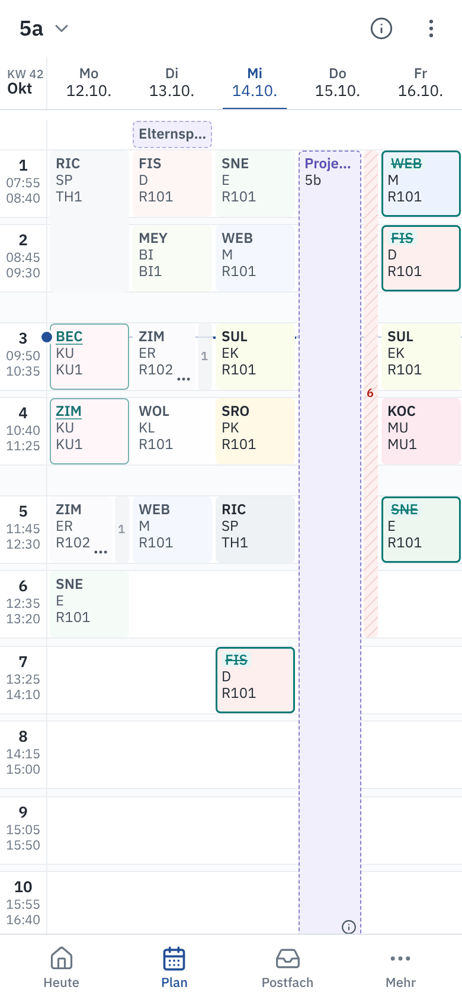
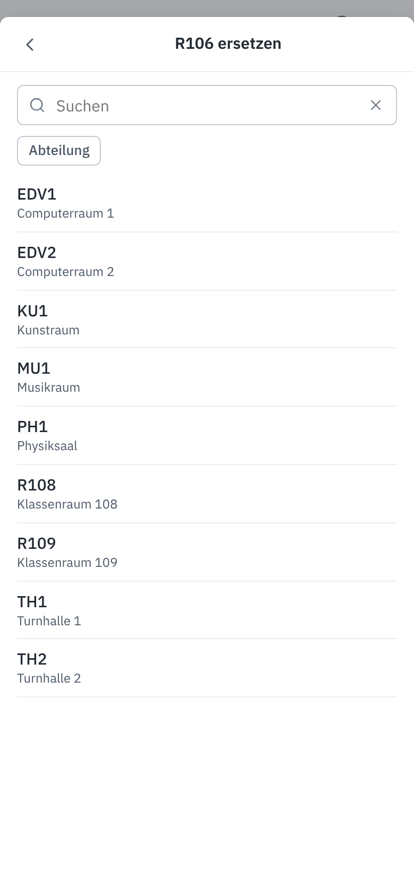
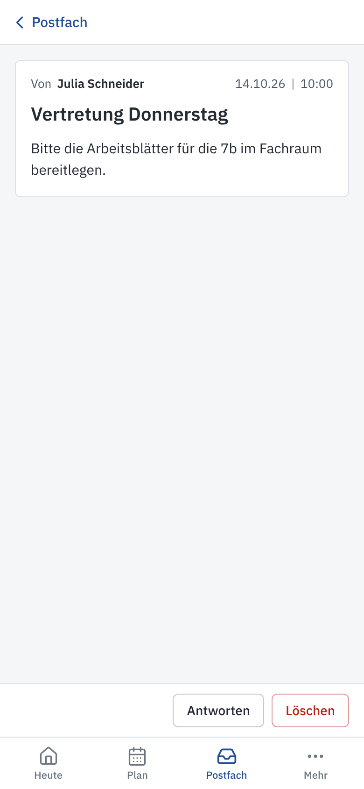
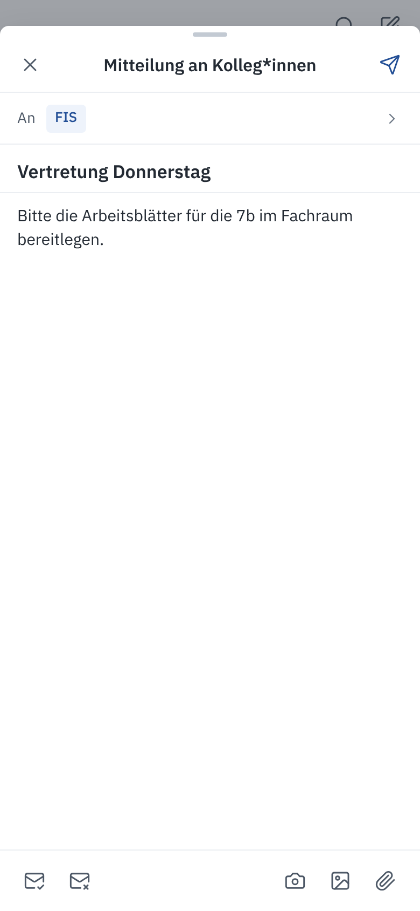
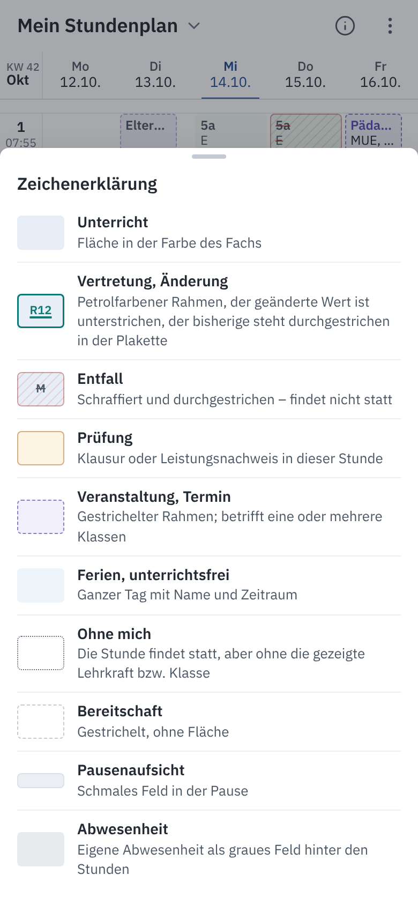

# UntPlan Mobile

Stundenplan, Vertretungen, Klassenbuch und Mitteilungen von UntPlan Web auf dem Telefon – als installierbare App (PWA).
UntPlan Mobile hat keine eigene Datenbank: Die App holt alles von einer laufenden UntPlan-Web-Instanz; angemeldet wird mit
dem Konto von UntPlan Web.

| Heute | Plan (Woche) | Plan (Tag) | Klassenplan |
|---|---|---|---|
|  |  |  |  |

| Stundendetails | Schüler*innen | Raum ersetzen | Plan auswählen |
|---|---|---|---|
|  |  |  |  |

| Postfach | Mitteilung | Schreiben | Mehr |
|---|---|---|---|
|  |  |  |  |

| Termine | Menü des Plans | Zeichenerklärung | Anmeldung |
|---|---|---|---|
|  |  |  |  |

| Dunkel: Plan | Dunkel: Details | Dunkel: Heute | Dunkel: Mehr |
|---|---|---|---|
|  |  |  |  |

## Aufbau der App

Untere Leiste mit vier Bereichen; jede Seite hat einen großen Titel, der beim Rollen in eine kompakte Kopfzeile übergeht.

| Bereich | Inhalt |
|---|---|
| **Heute** | Datum, Hinweise des Tages, die nächsten Stunden des eigenen Plans (mit Ferien), Übersicht: Termine und Prüfungen, eigene Abwesenheiten, Klassenleitung, Sprechtag |
| **Plan** | Stundenplan des eigenen Plans oder einer Klasse, Lehrkraft bzw. eines Raums; Woche, 2 Tage, 3 Tage, Tag; Stundendetails als Blatt von unten |
| **Postfach** | Posteingang, Gesendet, Entwürfe; Lesen, Antworten, Schreiben, Löschen, Suche |
| **Mehr** | Konto und Profilwechsel, weiteres Profil anmelden, Erscheinungsbild (Automatisch/Hell/Dunkel), Anzeigeoptionen, Benachrichtigungen, App installieren, Daten aktualisieren, Fassung, Abmelden |

## Funktionen

- **Stundenplan** für den eigenen Plan, Klassen, Lehrkräfte und Räume:
  - Zeitproportionales Raster; Zeitspalte mit Stundennummer, Beginn und Ende; Pausen als graue Bänder; Jetzt-Linie
    (Marine) mit Punkt am Rand der Zeitspalte; der Plan öffnet an der aktuellen Uhrzeit.
  - Kacheln mit der Fachfarbe als Tönung der Fläche. Zustände: **Änderung/Vertretung** mit Petrol-Rahmen, der geänderte
    Wert unterstrichen, ein noch offener bisheriger Wert durchgestrichen in der Plakette; **Entfall** schraffiert und
    durchgestrichen; **Prüfung** bernsteinfarben; **Veranstaltung/Termin** hell-violett mit gestricheltem Rahmen;
    **Ferien** hellblau mit Name und Zeitraum. Auf breiten Kacheln (Tagesansicht, Tablet) steht zusätzlich eine
    Statusplakette oben rechts.
  - Stunden, die **ohne mich** laufen (abgegeben, Kopplung ohne die Lehrkraft, Freisetzung der Klasse im Lehrer- und
    Raumplan), stehen ohne Fläche mit gepunktetem Rahmen und der Plakette „ohne mich“ bzw. „Klasse fehlt“.
  - Bereitschaften gestrichelt ohne Fläche; Pausenaufsichten als schmales Feld in der Pause (vertreten mit
    Petrol-Rahmen und „…“, abgegeben gepunktet, entfallen schraffiert).
  - Parallele Stunden mit Zählkarte (Petrol bei Änderung, schraffiert bei Entfall); Tippen öffnet den Tag mit allen
    Stunden nebeneinander. Gekoppelte Stunden mit unterschiedlichen Fächern sind eigene Kacheln.
  - Trennzeichen: auf den Kacheln Kommas, in den Stundendetails „ | “. Zu lange Werte enden mit „…“.
  - Offene Raumvertretungen (Platzhalter „???“) wie offene Lehrervertretungen; in den Details die Plakette „Raum offen“.
  - Veranstaltungen laufen als ein Block über Pausen mit Aufsicht hinweg; in der Tagesansicht steht die Aufsicht als
    halbe Kachel daneben.
  - Zeichen unten rechts für Information, Online-Unterricht und fällige Hausaufgaben; „…“ bei gekürzter Kachel.
  - Eigene Abwesenheiten als graues Feld hinter den Stunden (abschaltbar im Menü des Plans).
  - Wischen zwischen Wochen bzw. Tagen (Nachbarwochen vorgeladen), „Gehe zu Datum“, Zeichenerklärung.
  - Gesperrte Wochen (Planfenster der Rolle) mit Hinweis; Klassenkonten sehen nur die eigene Klasse und Räume.
- **Stundendetails** als Blatt von unten: Datum und Uhrzeit (bei Blöcken auf eine einzelne Stunde umschaltbar), Reiter
  für gleichzeitige Stunden, Kopf mit Klasse, Kurs, Fach, Raum und Lehrkraft (geänderte Werte: alt durchgestrichen, neu
  daneben), Plakette für Prüfung, Veranstaltung oder Zusatzstunde; Menü „…“ führt in die Pläne von Klasse, Lehrkraft und
  Raum. Zeilen für „Findet online statt“, Raum (Ersetzen, Hinzufügen, Löschen über die freien buchbaren Räume),
  Vertretungstext bzw. Information, Lehrstoff, Schüler*innen, Hausaufgaben, Klassenbucheinträge und Notizen.
- **Schüler*innen:** Filter Alle/Abwesend/Anwesend, Stand der Kontrolle, Gruppen nach Anfangsbuchstaben mit Leiste rechts,
  Zustand per Tippen oder Wischen (anwesend, abwesend, verspätet), „alle anwesend“, Abwesenheit minutengenau bearbeiten,
  gemeinsamer Klassenbucheintrag für mehrere Schüler*innen.
- **Heute:** die nächsten Stunden des eigenen Plans, Hinweise des Tages, Ferien der nächsten sieben Tage; Listen für
  Termine und Prüfungen, eigene Abwesenheiten, für Klassenleitungen die Fehlzeiten der Klasse mit Entschuldigen
  (Wischen oder Dialog) und der Sprechtag.
- **Postfach:** Posteingang, Gesendet und Entwürfe, Lesen, Antworten, Schreiben (Kolleg*innen oder einzelne Empfänger,
  Filter nach Liste, Klasse, Abteilung), Anhänge, Lesebestätigung, Löschen.
- **Offline:** Der Service Worker hält App, Schriften und die zuletzt geladenen Wochen vor. Jede neue Fassung erneuert
  den Cache auf den Geräten automatisch (Prüfwert über alle Dateien der Oberfläche).

Nicht in der App (nur in UntPlan Web): Abwesenheitsgründe verwalten, „Erziehungsberechtigte benachrichtigt“. Klassenkonten
sehen keine Fehlzeiten einzelner Schüler*innen.

## Installation mit Docker

UntPlan Mobile läuft neben UntPlan Web, als eigener Container auf **Port 8081**. Die Datei `docker-compose.yml` startet beide:

```bash
mkdir untplan && cd untplan
curl -O https://raw.githubusercontent.com/florians25/UntPlan/main/mobile/docker-compose.yml
docker compose up -d
```

- UntPlan Web: `http://<server>:8080` – Schule einrichten, UntPlan verbinden, Konten anlegen (siehe [UntPlan Web](../web/README.md)).
- UntPlan Mobile: `http://<server>:8081` – mit einem Konto von UntPlan Web anmelden.

**Ausprobieren mit Beispieldaten:** In `docker-compose.yml` bei UntPlan Web `UNTPLANWEB_DEMO: "1"` und
`UNTPLANWEB_ADMIN_PASSWORT: "admin12345"` setzen. Konten für Lehrkräfte und Klassen legt UntPlan Web unter
*Administration → Benutzer → Konten aus Stammdaten* an.

**Läuft UntPlan Web schon** (z. B. mit der Compose-Datei aus `web/`), genügt UntPlan Mobile allein:

```bash
docker run -d --name untplanmobile -p 8081:8081 -e UNTPLANWEB_URL=http://<server>:8080 ghcr.io/florians25/untplanmobile
```

**Selbst bauen** (Wurzel des UntPlan-Repositorys): `docker build -f mobile/Dockerfile -t untplanmobile .`

### Als App installieren (HTTPS)

Service Worker und „Zum Home-Bildschirm“ funktionieren nur über HTTPS (oder `localhost`). Im Betrieb gehört
UntPlan Mobile deshalb hinter einen Reverse-Proxy mit Zertifikat, zum Beispiel Caddy:

```
plan.meine-schule.de {
    reverse_proxy untplanweb:8080
}
app.meine-schule.de {
    reverse_proxy untplanmobile:8081
}
```

UntPlan Mobile wertet `X-Forwarded-Proto` und `X-Forwarded-Host` aus und setzt das Sitzungscookie dann als `Secure`.

### Einstellungen (Umgebungsvariablen)

| Variable | Bedeutung | Standard |
|---|---|---|
| `UNTPLANWEB_URL` | Adresse von UntPlan Web aus Sicht des Containers | `http://untplanweb:8080` (Image), `http://localhost:8080` (Entwicklung) |
| `UNTPLANWEB_PUBLIC_URL` | Adresse von UntPlan Web aus Sicht des Browsers (für die Einmalanmeldung) | gleicher Rechnername, Port 8080 |
| `UNTPLANMOBILE_ZEITZONE` | Zeitzone der Schule (heutiger Tag, aktuelle Woche) | `Europe/Berlin` |
| `ASPNETCORE_HTTP_PORTS` | Port im Container | `8081` |
| `UNTPLANMOBILE_UPDATE_PRUEFEN` | `0` = nicht nach neuen Versionen suchen | an |
| `UNTPLANMOBILE_UPDATE_URL` | Quelle der neuesten Version (wie `UNTPLANWEB_UPDATE_URL`, z. B. `ghcr://florians25/untplanmobile`) | GitHub-Releases von florians25/UntPlan |
| `UNTPLANMOBILE_UPDATE_TAG_PRAEFIX` | nur Tags mit diesem Präfix berücksichtigen | – |

### Installation mit MariaDB/MySQL

UntPlan Mobile selbst speichert keine Daten – es ist ein Proxy vor UntPlan Web. Die Datenbank betrifft nur UntPlan Web;
`docker-compose.mariadb.yml` startet MariaDB (Volume, Healthcheck), UntPlan Web mit `UNTPLANWEB_DB=mysql` und UntPlan Mobile:

```bash
mkdir untplan && cd untplan
curl -O https://raw.githubusercontent.com/florians25/UntPlan/main/mobile/docker-compose.mariadb.yml
curl -O https://raw.githubusercontent.com/florians25/UntPlan/main/mobile/update.sh && chmod +x update.sh
printf 'MARIADB_PASSWORT=…\nMARIADB_ROOT_PASSWORT=…\nWATCHTOWER_TOKEN=…\nCOMPOSE_FILE=docker-compose.mariadb.yml\n' > .env
docker compose up -d
```

Einzelheiten (eigener Datenbankserver, Verbindungszeichenfolge, Technik): [UntPlan Web – Installation mit MariaDB/MySQL](../web/README.md#installation-mit-mariadbmysql).

### Update

Wie bei UntPlan Web ist ein Update ein neues Image; UntPlan Mobile hat keine Migrationen und keinen Zustand außer den Sitzungen,
die an UntPlan Web hängen. Beide Dienste zusammen aktualisieren:

```bash
./update.sh                       # Sicherung von UntPlanWeb (SQLite bzw. MariaDB), docker compose pull, docker compose up -d
# oder von Hand:
docker compose pull && docker compose up -d
```

- **Versionsanzeige:** `GET /api/version` liefert Version, neueste veröffentlichte Version und ob ein Update verfügbar ist
  (gleiche Prüflogik wie UntPlan Web, Datei `web/src/UntPlanWeb/Dienste/Updatepruefung.cs` wird eingebunden). Mit
  `UNTPLANWEB_MOBILE_INTERN_URL=http://untplanmobile:8081` bei UntPlan Web (in den Compose-Dateien gesetzt) erscheint die Version von
  UntPlan Mobile auch in UntPlan Web unter *Administration → Übersicht → Version & Updates*.
- **Update aus der Oberfläche:** UntPlan Mobile hat keine eigene Administration. Der Knopf *Update installieren* in UntPlan Web
  stößt Watchtower an (`docker compose --profile updater up -d`), das alle Container mit dem Label
  `com.centurylinklabs.watchtower.enable=true` aktualisiert – also UntPlan Web und UntPlan Mobile, nicht MariaDB. Alternativ
  Anforderungsdatei plus cron (`./update.sh --wenn-angefordert`), siehe [UntPlan Web – Update](../web/README.md#update).
- Nach dem Update lädt die App auf den Telefonen die neue Oberfläche automatisch: Der Service Worker trägt eine Fassung
  (Prüfwert über alle Dateien) im Cachenamen.

### Datenmigration

UntPlan Mobile hat keine eigenen Daten. Für den Umstieg von UntPlan Web von SQLite auf MariaDB im selben Ordner:

```bash
docker compose down
curl -O https://raw.githubusercontent.com/florians25/UntPlan/main/mobile/docker-compose.mariadb.yml   # .env wie oben
docker compose -f docker-compose.mariadb.yml run --rm untplanweb --migrieren-nach-mysql
docker compose -f docker-compose.mariadb.yml up -d
```

Siehe [UntPlan Web – Datenmigration](../web/README.md#datenmigration).

## Verbindung zu UntPlan Web

UntPlan Mobile spricht ausschließlich die JSON-API von UntPlan Web (`/api/app/*`) an:

- **Anmeldung:** `POST /api/login` gibt Benutzername und Passwort an `POST /api/app/anmelden` weiter. Das Sitzungscookie
  von UntPlan Web bekommt der Browser als eigenes Cookie `untplanmobile` (HttpOnly, SameSite=Lax); UntPlan Mobile reicht
  es bei jedem Aufruf als `untplanweb` weiter und führt Erneuerungen und Abmeldungen nach. Ändernde Aufrufe tragen den
  Kopf `X-UntPlanWeb: 1`, den UntPlan Web verlangt. Ohne gültige Sitzung antworten alle Endpunkte mit HTTP 401, die
  App zeigt dann die Anmeldung.
- **Rechte** prüft allein UntPlan Web (z. B. Lehrerpläne nicht für Klassenkonten, Klassenbuch nur für die eigene Stunde);
  dessen Fehlermeldungen kommen unverändert in der App an.

| UntPlan Mobile | Aufgabe | UntPlan Web |
|---|---|---|
| `GET /` | App-Hülle mit Startdaten (`window.TT_BOOT`: eigener Plan, Stammdaten, aktuelle Woche) | `sitzung`, `elemente`, `plan` |
| `GET /api/mobile?action=meta` | eigener Plan, Klassen/Lehrkräfte/Räume, Stundenzeiten, Langnamen | `sitzung`, `elemente` |
| `GET /api/mobile?action=week&date=…&type=mine\|class\|teacher\|room&id=…` | eine Woche als Kacheln | `plan`, `klassenbuch/klasse` |
| `POST /api/login` (`action=login\|logout`) | An- und Abmelden | `anmelden`, `abmelden` |
| `GET/POST /api/classbook` | Lehrstoff, Hausaufgaben, Notizen für Schüler*innen und Lehrkräfte, Klassenbucheinträge, Bemerkungen, Anwesenheit, Klassendienste, „Findet online statt“ (`action=online`), gemeinsamer Klassenbucheintrag (`action=remarkMany`); `canEdit` sagt, ob es die eigene Stunde ist | `klassenbuch/stunde`, `klassenbuch/hausaufgabenliste`, `klassenbuch/anwesenheit`, `klassenbuch/vermerke`, `klassenbuch/klasse`, `klassendienste`, `klassenbuch/online` |
| `GET/POST /api/rooms` (`action=free\|book\|change`) | freie buchbare Räume einer Stunde, Raum buchen; `change` mit `op=replace\|add\|remove` (Raum-Chip) | `meldungen/freieraeume`, `meldungen/raumbuchung`, `mobil/raum` |
| `GET/POST /api/home` | Startseite, Termine, Abwesenheiten, Fehlzeiten der Klasse, Entschuldigen | `heute`, `meldungen`, `klassenbuch/fehlzeiten` |
| `GET/POST /api/messages` | Posteingang, Gesendet, Lesen, Schreiben, Löschen | `mitteilungen` |
| `GET /api/accounts` | Profilwechsel (nicht unterstützt, leere Liste) | – |
| `GET /sw.js`, `/manifest.webmanifest`, `/assets/…` | Service Worker (mit Fassung), Manifest, Oberfläche | – |
| `GET /gesundheit` | Gesundheitsprüfung (Docker) | – |

**Übersetzung der Karten:** Die Stundenkarten von UntPlan Web werden in die Kacheln der Oberfläche übersetzt
(`Dienste/Kachelbau.cs`):

| UntPlan Web | Kachel |
|---|---|
| `regulaer` | `normal` |
| `geaendert`, `vorgemerkt` | `change` (geänderte Werte mit `…Orig` und `changed`) |
| `geaendert` als Zusatzstunde (Sondereinsatz, Zusatz…, Verlegung, ohne Unterricht) | `change` mit `extra` (Plakette in den Details), ohne Lehrkraft `teacher: "---"` |
| `offen` | `change` mit `openSub` (alter Wert durchgestrichen) |
| `abwesend` (Lehrer-/Raumplan) | `change` mit dem eigenen Kürzel als `teacherOrig` (läuft „ohne mich“) |
| `entfall` | `cancelled` |
| `entfall` mit Art Freisetzung/Klassenabwesenheit | `change` mit `classAbsent` (Klasse als `classOrig`) |
| Raumänderung ohne neuen Raum, Raum „???“ | `openRoom` (bisheriger Raum als `roomOrig`) |
| `klausur` | `klausur` |
| `bereitschaft` | `standby` (Stunden mit gehaltener Vertretung entfallen) |
| `veranstaltung`, Teilnahme ohne Fach | `absence` mit `overlay` (Veranstaltungsfeld) |
| `buchung` | `event` |
| freier Tag (`ferien`, `feiertag`, `frei`) | `holiday` mit `holidayName` und `holidayRange` |
| Pausenaufsicht | `supervision` (`_supAbsent` vertreten, `_supSub` übernommen) |

Für die Zeiträume der Ferienfelder liefert UntPlan Web unter `/api/app/elemente` zusätzlich die Liste `ferien`.

**Raumänderung aus der App** (`POST /api/app/mobil/raum` in UntPlan Web, `Api/MobilApi.cs`): ersetzen, hinzufügen oder
löschen. Gespeichert wird wie jede Raumbuchung als Rückmeldung „raumbuchung“ mit der vollständigen Raumliste (neuer Raum
vorn – UntPlan übernimmt ihn als Vertretungsraum, die übrigen als Zusatzräume). Je Lehrkraft und Stunde gibt es höchstens
eine offene Raumänderung; ergibt sich wieder die ursprüngliche Raumliste, wird sie nur zurückgezogen. Neue Räume müssen
buchbar und frei sein.

## Mehrere Profile und Benachrichtigungen (Web-Push)

- **Mehrere Profile je Gerät:** Unter „Mehr → Weiteres Profil anmelden“ meldet sich ein weiteres Konto an, ohne das bisherige abzumelden. Gewechselt wird über die Kontozeile unter „Mehr“. Die Sitzungen liegen verschlüsselt (ASP.NET Data Protection) im Datenordner von UntPlan Mobile; das Gerät trägt nur eine Zufallskennung als Cookie. „Abmelden“ meldet nur das aktuelle Profil ab.
- **Benachrichtigung sofort nach dem Import:** UntPlan Mobile prüft jede Minute (`UNTPLANMOBILE_PUSH_INTERVALL`, Sekunden, `0` = aus) den Planstand von UntPlan Web. Ändert sich der eigene Plan eines Profils mit eingeschalteten Benachrichtigungen, geht ein Web-Push (RFC 8291/8292, eigene Implementierung ohne Fremdbibliothek) an das Gerät. Am iPhone/iPad funktioniert das in der App vom Homescreen ab iOS 16.4; HTTPS ist Voraussetzung.
- **Datenordner:** `UNTPLANMOBILE_DATEN` (im Container `/data`, Volume `untplanmobile-daten`) enthält `konten.json`, `vapid.json` (VAPID-Schlüssel, beim ersten Start erzeugt) und die Data-Protection-Schlüssel. Kontakt für die Push-Dienste: `UNTPLANMOBILE_VAPID_KONTAKT` (`mailto:` oder `https:`).

## Entwicklung

```bash
# UntPlanWeb mit Beispieldaten (Port 5190)
cd web && UNTPLANWEB_DEMO=1 UNTPLANWEB_ADMIN_PASSWORT=admin12345 dotnet run --project src/UntPlanWeb --urls http://localhost:5190
# UntPlanMobile dagegen (Port 5191)
cd mobile && UNTPLANWEB_URL=http://localhost:5190 dotnet run --project src/UntPlanMobile --urls http://localhost:5191
# Tests (starten UntPlanWeb im Testprozess)
dotnet test mobile/tests/UntPlanMobile.Tests
```

Aufbau:

- `src/UntPlanMobile`: ASP.NET Core 8 (Minimal-APIs) ohne eigene Datenbank.
  - `Dienste/UntPlanWebVerbindung.cs`: Aufrufe an UntPlan Web mit durchgereichtem Sitzungscookie.
  - `Dienste/Kachelbau.cs`: Wochenplan → Kacheln; `Dienste/Wochendienst.cs`: Wochen, Stammdaten, Startdaten.
  - `Api/`: die Endpunkte der Oberfläche (Stundenplan, Anmeldung, Klassenbuch, Startseite, Mitteilungen) und `VersionApi.cs` (`/api/version`).
  - `Vorlagen/index.html`, `Vorlagen/sw.js`: App-Hülle und Service Worker; der Server setzt Symbolsammlung,
    Startdaten (mit CSP-Nonce) und Fassung ein.
  - `wwwroot/`: die Oberfläche ohne Build-Schritt – `app.js`, `tokens.css`, `app.css`, Schriften, Symbole und Manifest.
- `tests/UntPlanMobile.Tests`: Übersetzung der Karten und Ende-zu-Ende-Tests gegen UntPlan Web mit dem Beispielpaket.

Die Oberfläche folgt dem gemeinsamen Designsystem von UntPlan (`design/DESIGN.md`): Grundwerte in
`wwwroot/assets/css/tokens.css` (Kopie von `design/tokens.css`), Schrift IBM Plex Sans (SIL OFL, `wwwroot/assets/fonts`),
Linien-Symbole aus Lucide (ISC, `wwwroot/assets/icons/LUCIDE-LICENSE.txt`) in der eingebetteten Symbolsammlung
`symbole-sprite.svg`. App-Symbole und Favicon entstehen aus dem Monogramm `design/logo/monogramm.svg`. Es gibt keinen
Build-Schritt und keine Abhängigkeiten aus dem Netz.

UntPlan Mobile gehört weder zur Desktop-Solution `UntPlan.sln` noch zu `web/UntPlanWeb.sln`, sondern hat die eigene
Solution `UntPlanMobile.sln` und einen eigenen CI-Ablauf (`.github/workflows/mobile.yml`). Dieser testet und
veröffentlicht das Image `ghcr.io/florians25/untplanmobile`.

> Hinweis: Ein neues GHCR-Paket ist zunächst privat. Damit `docker pull` ohne Anmeldung funktioniert, stellen Sie es einmalig auf öffentlich:
> GitHub → Packages → untplanmobile → Package settings → Change visibility.

## Einmalanmeldung (SSO) über UntPlan Web

Beim ersten Aufruf leitet UntPlan Mobile automatisch zu UntPlan Web weiter. Wer dort schon angemeldet ist, landet ohne
Passworteingabe direkt im eigenen Plan. Sonst erscheint die Anmeldeseite von UntPlan Web, danach geht es zurück in die App.
Die Anmeldung mit Benutzername und Passwort in der App bleibt als Alternative erhalten.

- UntPlan Web gibt nur einen Einmal-Code heraus (2 Minuten gültig), den UntPlan Mobile serverseitig einlöst; Passwörter
  laufen nie über die Mobil-App.
- Erlaubte Rücksprungadressen: `UNTPLANWEB_MOBILE_URL` bei UntPlan Web (kommagetrennt, z. B. `https://m.meine-schule.de`).
  Ohne Angabe ist nur derselbe Rechnername (anderer Port) erlaubt.
- Liegen beide hinter verschiedenen Adressen (Reverse-Proxy), bei UntPlan Mobile `UNTPLANWEB_PUBLIC_URL` und bei UntPlan Web
  `UNTPLANWEB_MOBILE_URL` setzen.
