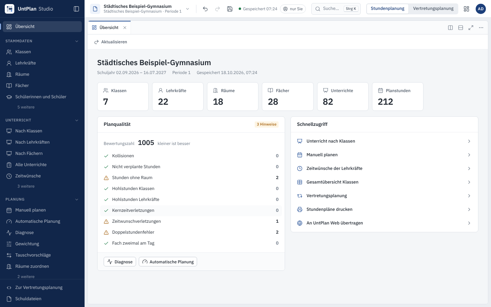
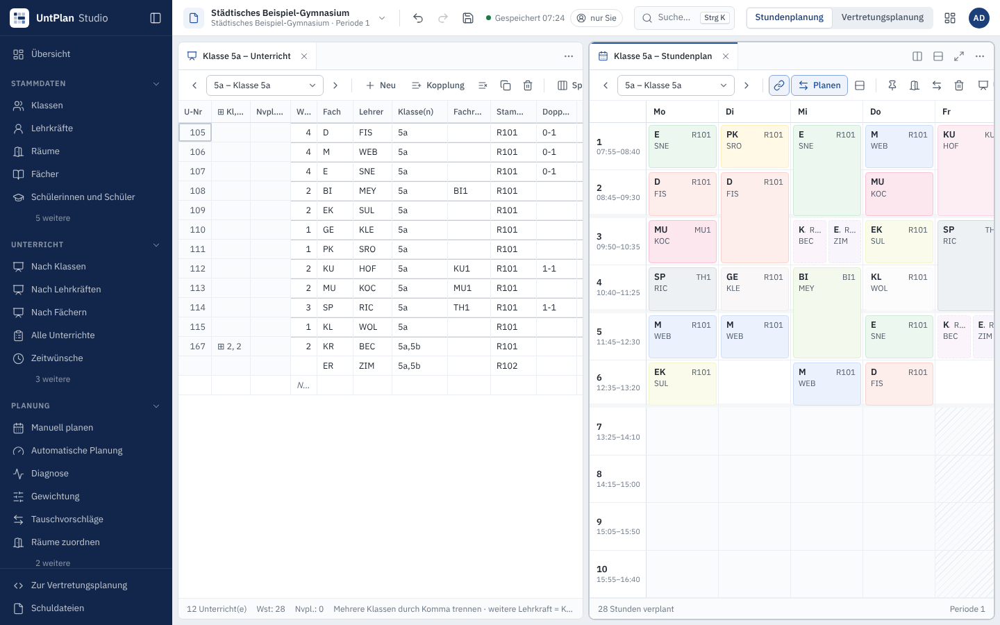
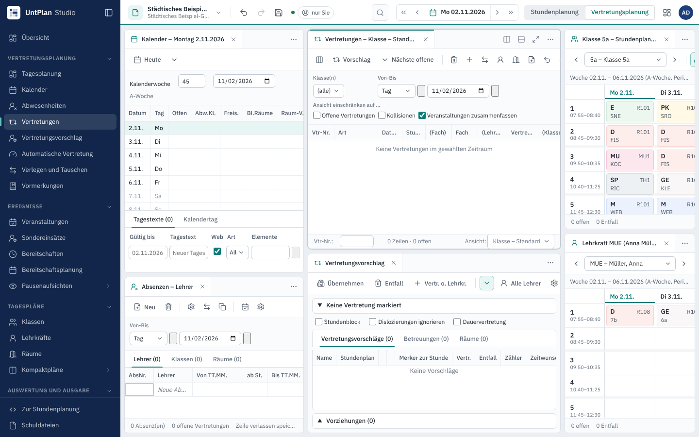
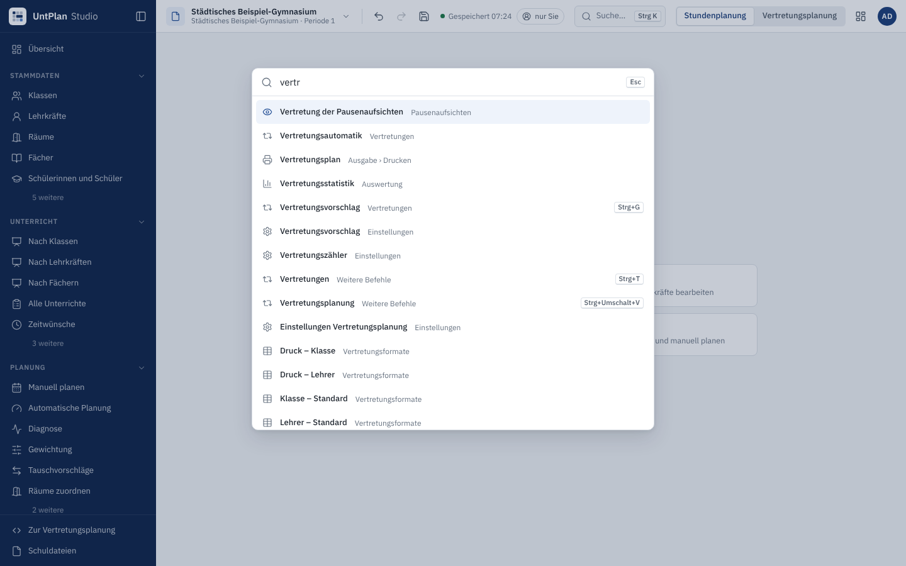

# UntPlan Studio

**Stunden-, Kurs- und Vertretungsplanung für Schulen – als Web-Anwendung.** UntPlan Studio ist das Planungswerkzeug
von UntPlan: Stammdaten, Unterricht, Zeitwünsche, automatische und manuelle Stundenplanung, Vertretungsplanung,
Pausenaufsichten, Auswertungen, Druck und Datenaustausch – im Browser, mit mehreren Benutzern gleichzeitig. Alle
Berechnungen laufen auf dem Server mit der Fachlogik aus `src/UntPlan.Core`.



| Manuell planen | Vertretungsplanung | Befehlssuche |
|---|---|---|
|  |  |  |

## Oberfläche

* **Seitenleiste** mit den Arbeitsbereichen *Stammdaten, Unterricht, Planung, Stundenpläne, Oberstufe, Auswertung,
  Ausgabe, Datenaustausch, Schule* – im Vertretungsmodus zusätzlich *Vertretungsplanung, Ereignisse, Tagespläne,
  Auswertung und Ausgabe*. Selten gebrauchte Punkte stehen unter „weitere“. Strg+B klappt die Leiste ein.
* **Kopfleiste**: Schuldatei wählen (zuletzt verwendet, alle Dateien, neu, hochladen), Rückgängig/Wiederholen,
  Speichern mit Speicherstand und Live-Verbindung, aktive Benutzer, **Befehlssuche** (Strg+K – findet jede Funktion),
  Modus *Stundenplanung / Vertretungsplanung*, im Vertretungsmodus das Planungsdatum, Arbeitsbereich und Konto.
* **Arbeitsbereich**: Ansichten öffnen als Reiter. Reiter lassen sich an den Rand eines Bereichs ziehen (teilt ihn),
  über „Rechts teilen“/„Unten teilen“ nebeneinander stellen, Trenner verschieben, ein Bereich lässt sich vergrößern.
  Die Anordnung wird je Schuldatei gemerkt; eigene Anordnungen lassen sich speichern.
* **Übersicht**: Kennzahlen der Schuldatei, Planqualität (Kollisionen, Hohlstunden, Zeitwunschverletzungen …) und
  Schnellzugriff.

## Lokal starten

Voraussetzung: .NET 8 SDK.

```bash
cd studio/src/UntPlanStudio
STUDIO_ADMIN_PASSWORT=geheim123 ASPNETCORE_URLS=http://127.0.0.1:5501 dotnet run
```

Dann <http://127.0.0.1:5501> öffnen und mit `admin` / `geheim123` anmelden. Die Daten liegen im Ordner `daten/` neben
dem Projekt (oder unter `STUDIO_DATEN`). Ohne `STUDIO_ADMIN_PASSWORT` wird beim ersten Start ein zufälliges Passwort
erzeugt und im Protokoll ausgegeben.

Tests:

```bash
dotnet test studio/tests/UntPlanStudio.Tests -c Release      # API-Tests, Syntaxprüfung aller JS-Module (Node), Verweise
# Oberflächen-Smoke-Test (Server muss laufen, Playwright + Chromium nötig):
NODE_PATH=$(npm root -g) STUDIO_PASSWORT=geheim123 node studio/tests/smoke/smoke.cjs
NODE_PATH=$(npm root -g) STUDIO_PASSWORT=geheim123 node studio/tests/smoke/druck.cjs   # Einstellungen, Druck, Übersicht, Formate
```

## Container

Das Image wird vom GitHub-Workflow `.github/workflows/studio.yml` als `ghcr.io/florians25/untplanstudio` gebaut
(amd64 und arm64). Selbst bauen (Build-Kontext = Repository-Wurzel):

```bash
docker build -f studio/Dockerfile -t untplanstudio .
```

| Datei | Zweck |
|---|---|
| `docker-compose.yml` | HTTP auf Port 8090 (z. B. hinter einem vorhandenen Reverse-Proxy) |
| `docker-compose.https.yml` + `Caddyfile` | eigene Domain mit HTTPS (Let's Encrypt über Caddy) |
| `docker-compose.gemeinsam.yml` + `Caddyfile.gemeinsam` | UntPlan Web **und** Studio auf einem Server, je eigene Domain, ein Caddy |

```bash
cd studio
# einfach
STUDIO_ADMIN_PASSWORT=bitte-aendern docker compose up -d
# eigene Domain
STUDIO_DOMAIN=studio.meine-schule.de STUDIO_ADMIN_PASSWORT=bitte-aendern docker compose -f docker-compose.https.yml up -d
# zusammen mit UntPlan Web (statt web/docker-compose.https.yml)
UNTPLANWEB_DOMAIN=plan.meine-schule.de STUDIO_DOMAIN=studio.meine-schule.de STUDIO_ADMIN_PASSWORT=bitte-aendern \
  docker compose -f docker-compose.gemeinsam.yml up -d
```

Der Container läuft ohne Root-Rechte (Benutzer `app`), alle Daten liegen im Volume `/data`
(Schuldateien, Benutzer, Schlüssel für das Anmeldecookie). Sicherung = dieses Volume sichern.

## Umgebungsvariablen

| Variable | Standard | Bedeutung |
|---|---|---|
| `STUDIO_DATEN` | `./daten` (Container: `/data`) | Datenordner |
| `STUDIO_ADMIN_BENUTZER` | `admin` | Name des Admin-Kontos beim ersten Start |
| `STUDIO_ADMIN_PASSWORT` | – (zufällig, im Protokoll) | Passwort des Admin-Kontos beim ersten Start |
| `STUDIO_AUTOSPEICHERN_SEKUNDEN` | `30` | Takt der Autospeicherung geänderter Dokumente |
| `STUDIO_LEERLAUF_MINUTEN` | `120` | unbenutzte Dokumente werden danach gespeichert und entladen |
| `STUDIO_MAX_UPLOAD_MB` | `64` | Höchstgröße beim Hochladen |
| `STUDIO_SICHERE_COOKIES` | automatisch | `1` = Anmeldecookie nur über HTTPS (hinter Caddy empfohlen) |
| `STUDIO_DOMAIN` | – | nur Compose/Caddy: Domain des Studios |
| `ASPNETCORE_HTTP_PORTS` / `ASPNETCORE_URLS` | `8080` im Container | Port bzw. Adresse |

## Bedienung (Kurzüberblick)

* **Tabellen**: Enter/F2 oder Tippen bearbeitet, Tab/Pfeile wechseln die Zelle, Entf leert, Leertaste setzt Haken,
  Strg+C/Strg+V kopiert/fügt ein (auch aus Tabellenkalkulationen), Umschalt/Strg+Klick markiert mehrere Zeilen,
  Rechtsklick auf die Kopfzeile blendet Spalten ein/aus, Kopfzeile ziehen verschiebt Spalten.
* **Stundenplan**: Stunden per Drag & Drop verschieben oder tauschen; nicht verplante Stunden unten in den Plan ziehen.
  Ziel grün = frei, rot = Vorgabe verletzt, violett = kein Raum frei, Rahmen = Tausch möglich. Rechtsklick: fixieren,
  entplanen, Raum zuordnen, Tauschvorschläge.
* **Tastatur**: Strg+K Befehlssuche, Strg+S Speichern, Strg+Z/Strg+Y Rückgängig/Wiederholen, Strg+Umschalt+V Modus
  wechseln, Strg+B Seitenleiste, Strg+Bild↑/↓ Planungsdatum (Vertretungsmodus).

Für Entwickler: Aufbau, API-Konventionen und „Neues Modul anlegen“ stehen in [`ARCHITEKTUR.md`](ARCHITEKTUR.md).
