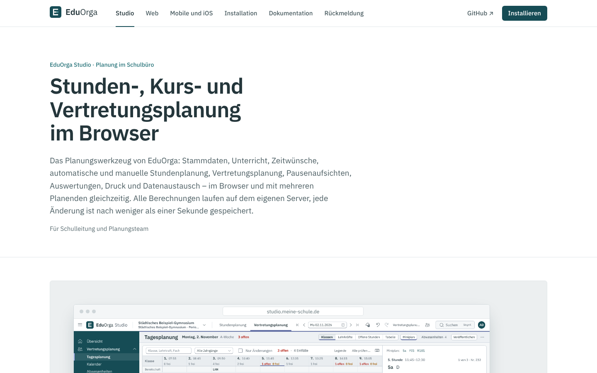
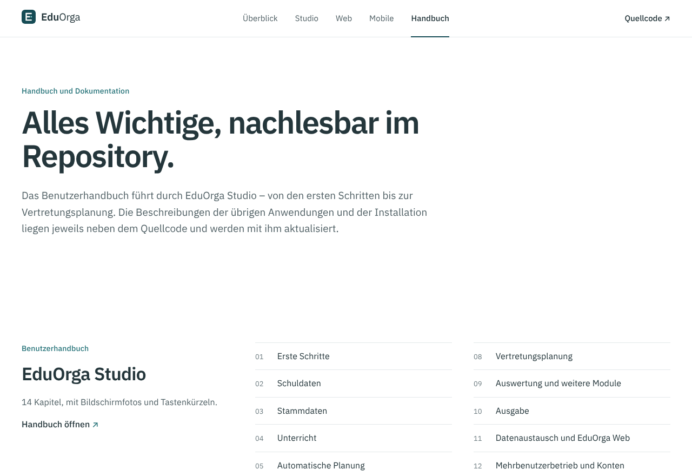
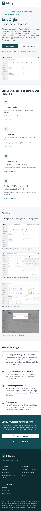

# EduOrga Website

Produkt-Website von **EduOrga** („Einfach mehr Schulalltag.“): Überblick, die Anwendungen Studio, Web, Mobile und die
App für iPhone und iPad, Installation, Handbuch sowie Hinweis, Impressum und Datenschutz. Marke, Farben und rechtlicher
Hinweis folgen [`design/MARKE.md`](../design/MARKE.md).

Die Website ist **nicht Teil der Installation an Schulen**. Betrieben wird sie getrennt mit
[`installation/intern/`](../installation/intern/README.md) (nur für den Betreiber des Projekts). Fehler, Wünsche und
Ideen laufen über GitHub: [Issues](https://github.com/florians25/EduOrga/issues) und
[Discussions](https://github.com/florians25/EduOrga/discussions) – ein eigenes Portal gibt es nicht.


| Anwendungen | Studio | Handbuch | Telefon |
|---|---|---|---|
|  |  |  |  |

## Seiten

| Adresse | Inhalt |
|---|---|
| `/` | Bühne mit Slogan und Bildschirmfotos (Studio im Browserfenster, Web auf dem Telefon), Statusleiste, die Anwendungen, Installation, Handbuch |
| `/studio`, `/web`, `/mobile` | je Anwendung: Beschreibung, Funktionen, weitere Ansichten, Technik; `/mobile#ios` die App für iPhone und iPad |
| `/installation` | Befehle aus [`installation/README.md`](../installation/README.md): Installation, Container und Ports, Update, Passwort, Einstellungen |
| `/handbuch` | Kapitel von [`docs/HANDBUCH.md`](../docs/HANDBUCH.md) (verlinkt auf GitHub), weitere Dokumentation, Rückmeldung über GitHub |
| `/hinweis`, `/impressum`, `/datenschutz` | rechtlicher Hinweis und Vorlagen mit Platzhaltern für die Betreiberangaben |

**Statusleiste** unter der Bühne: „Entwicklungsstand `<VERSION>` · Noch keine Veröffentlichung (bzw. Aktuelle Version
`<Tag>` vom `<Datum>`) · Letzte Änderung `<Datum>`“ und der Link „Projektstand & Änderungen“ (Releases, solange es keine
gibt die Liste der Commits). Die Werte ermittelt `client/scripts/vorbereiten.mjs` **beim Build** und schreibt sie nach
`client/src/stand.json` (Build-Ausgabe, nicht eingecheckt):

| Wert | Quelle |
|---|---|
| Version | Datei `VERSION` im Repository |
| Letzte Änderung, Commit | `WEBSITE_COMMIT_DATUM`/`WEBSITE_COMMIT`, sonst `git log -1`, sonst Zeitpunkt des Builds |
| Neueste Veröffentlichung | `WEBSITE_RELEASE` (`-` = keine) und `WEBSITE_RELEASE_DATUM`, sonst GitHub-API `releases/latest` (5 s Zeitlimit, `WEBSITE_OFFLINE=1` schaltet die Abfrage ab) |
| Kapitel des Handbuchs | Überschriften `## N. …` in `docs/HANDBUCH.md` |

**Datenschutz:** keine externen Schriften, Skripte oder Dienste (Content-Security-Policy `default-src 'self'`), kein
Tracking, keine Cookies, keine Formulare, keine Datenbank.

## Aufbau

```text
website/
├── client/                    Oberfläche: React 18, TypeScript (strict), Vite, React Router – ohne UI-Bibliothek
│   ├── scripts/vorbereiten.mjs  Schrift, Logo (design/), Bildschirmfotos (studio|web|mobile/docs/bilder) → public/, Stand → src/stand.json
│   └── src/                   seiten/, bausteine/ (Rahmen, Browserfenster, Telefon, Befehle), inhalt.ts (Texte), stand.ts, stil.css
├── src/EduOrgaWebsite/        Server: ASP.NET Core 8, liefert wwwroot aus (Schutzköpfe, SPA-Rückfall, /api/gesundheit, /api/info)
├── tests/EduOrgaWebsite.Tests xUnit-Tests (WebApplicationFactory)
├── docs/bilder/               Bildschirmfotos (Playwright)
└── Dockerfile                 Image ghcr.io/florians25/untplannext-website
```

Der Server ist bewusst klein: statische Dateien (Assets ein Jahr zwischenspeicherbar, `index.html` mit `no-cache`),
Seitenadressen liefern die `index.html`, `/api/gesundheit` für den Healthcheck und `/api/info` mit Version und
Betreiberangaben (für Impressum und Datenschutz). Bildschirmfotos und Logos werden beim Bauen aus dem Repository
übernommen und nicht doppelt eingecheckt (`client/public/bilder`, `fonts`, `logo` sind Build-Ausgabe).

## Lokal starten

Voraussetzung: .NET 8 SDK und Node.js 22.

```bash
cd website/src/EduOrgaWebsite
ASPNETCORE_URLS=http://127.0.0.1:5520 dotnet run
```

`dotnet build`/`run` baut die Oberfläche mit (`npm ci` beim ersten Mal, dann `npm run build`; abschalten mit
`-p:WebsiteOberflaecheBauen=false`). Dann <http://127.0.0.1:5520> öffnen.

Oberfläche mit sofortiger Aktualisierung:

```bash
cd website/client
npm ci
npm run dev          # Vite auf http://127.0.0.1:5173, leitet /api an WEBSITE_URL (Standard http://127.0.0.1:5520) weiter
npm run typecheck    # Stand erzeugen + tsc --noEmit
npm run build        # Stand erzeugen + Typprüfung + Build nach ../src/EduOrgaWebsite/wwwroot
```

Tests:

```bash
dotnet test website/tests/EduOrgaWebsite.Tests -c Release
```

Sie prüfen: alle Seitenadressen liefern die Oberfläche (ohne Cookies), Schutzköpfe und Content-Security-Policy,
Zwischenspeichern der Assets, Gesundheit, Betreiberangaben aus der Umgebung, frühere Portaladressen antworten mit 404.

## Einstellungen (Umgebungsvariablen)

| Variable | Standard | Bedeutung |
|---|---|---|
| `WEBSITE_BETREIBER_NAME`, `…_ANSCHRIFT`, `…_EMAIL` | – | Angaben für Impressum und Datenschutz (leer = Platzhalter) |

`dotnet EduOrgaWebsite.dll --gesundheitspruefung` dient dem Docker-Healthcheck.

## Container und Betrieb

Das Image baut der Workflow `.github/workflows/website.yml` als `ghcr.io/florians25/untplannext-website` (amd64 und
arm64; Tag `v1.2.3` → Version `1.2.3`, sonst `<VERSION>-dev.<Lauf>`; Commits mit `[skip ci]` werden übersprungen). Er
übergibt Commit, Datum der letzten Änderung und die neueste Veröffentlichung als Build-Argumente für die Statusleiste.
Selbst bauen (Build-Kontext = Repository-Wurzel):

```bash
docker build -f website/Dockerfile -t untplannext-website \
  --build-arg WEBSITE_COMMIT_DATUM="$(git log -1 --format=%cI)" --build-arg WEBSITE_COMMIT="$(git rev-parse HEAD)" .
docker run -p 8290:8080 untplannext-website
```

Betrieb auf dem Server: [`installation/intern/README.md`](../installation/intern/README.md) (`installation/install-intern.sh`,
Port 8290, optional eigener Caddy für HTTPS). Vor der Veröffentlichung Impressum- und Datenschutzangaben setzen und die
Texte (Vorlagen, keine Rechtsberatung) prüfen.

## Hinweis

EduOrga ist ein privates Hobbyprojekt eines Auszubildenden zum Fachinformatiker für Systemintegration, entwickelt mit
Unterstützung von Claude (Anthropic). Jede Schule bzw. jeder Betreiber ist für Einsatz, Betrieb und Datenschutz selbst
verantwortlich.
