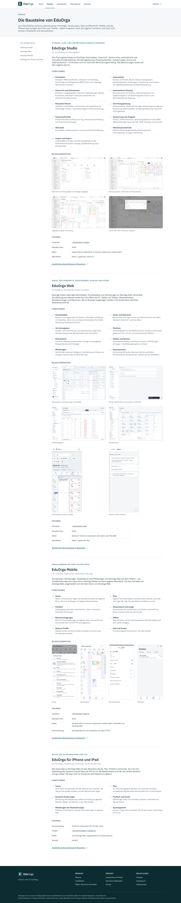
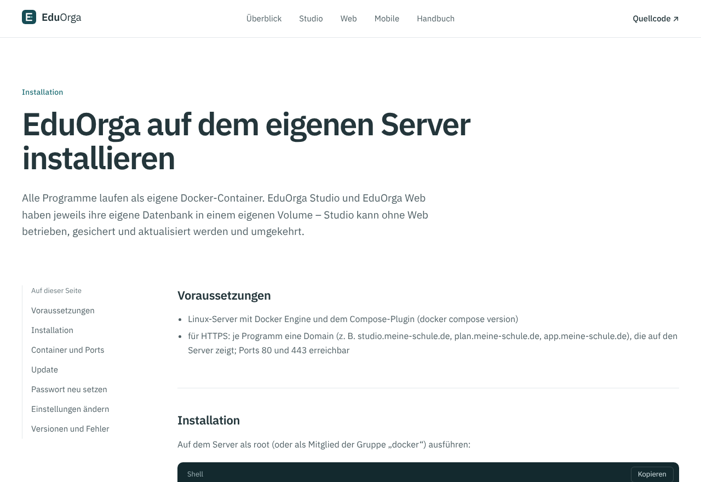
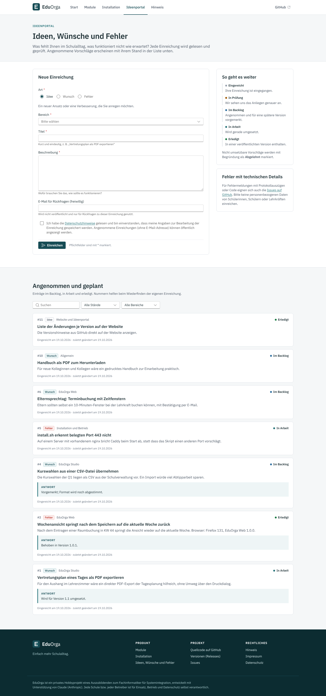
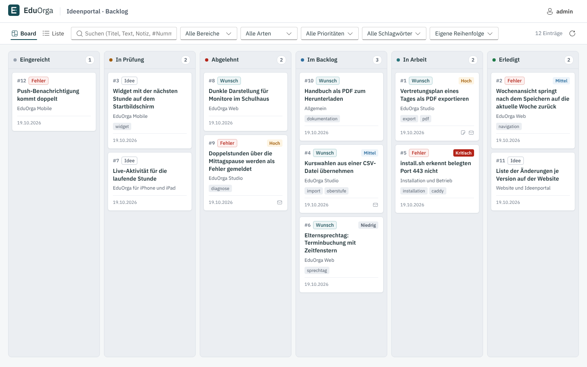
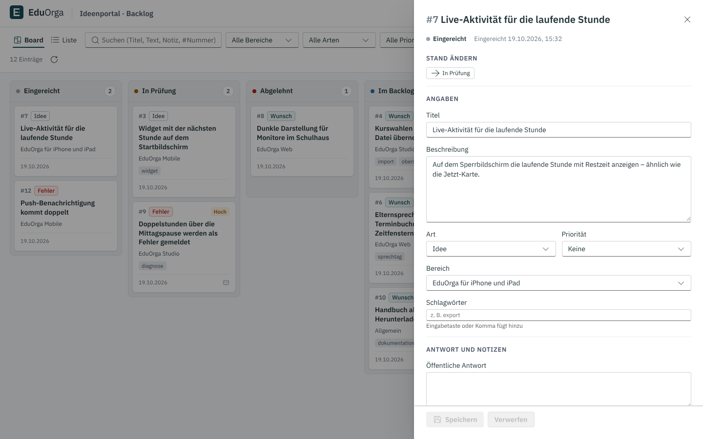

# EduOrga Website

Produkt-Website von **EduOrga** („Einfach mehr Schulalltag.“) mit **Ideen-, Wunsch- und Fehlerportal** und einer
Verwaltung für das Backlog. Marke, Farben und rechtlicher Hinweis folgen [`design/MARKE.md`](../design/MARKE.md).


| Module | Installation | Ideenportal |
|---|---|---|
|  |  |  |

| Verwaltung: Board | Verwaltung: Eintrag | Telefon |
|---|---|---|
|  |  |  |

## Inhalt

**Öffentliche Seiten** (deutsch): Start (Name, Slogan, Nutzen, Bildschirmfotos), Module (EduOrga Studio, Web, Mobile,
iPhone/iPad-App mit Funktionen und Technik), Installation (Befehle aus `installation/README.md`, Update, Passwort,
Ports), Ideenportal, Hinweis (rechtlicher Hinweis, Lizenzen), Impressum und Datenschutz (Vorlagen mit Platzhaltern).

**Ideenportal** (`/portal`): Formular mit Art (Idee/Wunsch/Fehler), Bereich, Titel, Beschreibung, freiwilliger E-Mail
und Einwilligung. Schutz gegen Automaten: unsichtbares Feld (Honigtopf), Mindestbearbeitungszeit und Begrenzung je
IP-Adresse (nur gehasht im Arbeitsspeicher). Darunter die öffentliche Liste angenommener Einträge (*Im Backlog*,
*In Arbeit*, *Erledigt*) mit Stand und öffentlicher Antwort – ohne E-Mail, Notizen, Priorität oder Schlagwörter.

**Verwaltung** (`/verwaltung`): Anmeldung als Administrator, dann das Backlog

- als **Board** mit einer Spalte je Stand; Karten per Drag & Drop (dnd-kit; Maus, Touch, Tastatur: Leertaste greift
  und legt ab) zwischen Spalten verschieben und innerhalb einer Spalte ordnen. Beim Ziehen sind erlaubte Zielspalten
  gestrichelt markiert, alle anderen abgeblendet;
- oder als **Liste** mit Sortierung nach jeder Spalte;
- Suche (Titel, Text, Notiz, Schlagwort, `#Nummer`), Filter nach Bereich, Art, Priorität und Schlagwort;
- Seitenbereich je Eintrag: Titel und Beschreibung bearbeiten, Art, Bereich, Priorität, Schlagwörter, öffentliche
  Antwort, interne Notiz, Sichtbarkeit in der öffentlichen Liste, E-Mail-Adresse löschen, Verlauf aller Änderungen,
  Löschen.

**Ablauf der Stände:** Eingereicht → In Prüfung → Abgelehnt (nur mit Begründung) oder Im Backlog → In Arbeit →
Erledigt. Rückwege (wieder prüfen, zurück ins Backlog, wieder öffnen) sind erlaubt, Abkürzungen nicht; der Server
prüft jeden Wechsel (`Daten/Modell.cs`, `Status`).

**Datenschutz:** keine externen Schriften, Skripte oder Dienste (strikte Content-Security-Policy `default-src 'self'`),
kein Tracking, öffentliche Seiten ohne Cookies; nur die Verwaltung setzt ein Sitzungs-Cookie (`edo_verwaltung`,
HttpOnly, SameSite=Strict). E-Mail-Adressen abgeschlossener Einträge werden nach `WEBSITE_EMAIL_AUFBEWAHRUNG_TAGE`
(Standard 180) automatisch gelöscht.

## Aufbau

```text
website/
├── client/                    Oberfläche: React 18, TypeScript (strict), Vite, Fluent UI v9, dnd-kit
│   ├── scripts/vorbereiten.mjs  übernimmt Schrift, Logo (design/) und Bildschirmfotos (studio|web|mobile/docs/bilder) nach public/
│   └── src/                   seiten/ (öffentlich), verwaltung/ (Board, Liste, Detail), bausteine/, inhalt.ts (Texte), stil.css
├── src/EduOrgaWebsite/        Server: ASP.NET Core 8, Minimal API, SQLite (Microsoft.Data.Sqlite)
│   ├── Api/Endpunkte.cs       /api/eintraege, /api/einreichungen, /api/admin/…
│   ├── Daten/                 Modell (Stände, Übergänge), Datenbank (Schema, Sicherung), Einträge, Verlauf
│   └── Dienste/               Konfiguration, Benutzer (PBKDF2-SHA256), Ratenbegrenzung
├── tests/EduOrgaWebsite.Tests xUnit-Tests der API (WebApplicationFactory)
├── docs/bilder/               Bildschirmfotos (Playwright)
└── Dockerfile                 Image ghcr.io/florians25/untplannext-website
```

Die Bildschirmfotos und Logos werden beim Bauen aus dem Repository übernommen und nicht doppelt eingecheckt
(`client/public/bilder`, `fonts`, `logo` sind Build-Ausgabe).

## Lokal starten

Voraussetzung: .NET 8 SDK und Node.js 22.

```bash
cd website/src/EduOrgaWebsite
WEBSITE_ADMIN_PASSWORT=geheim12345 ASPNETCORE_URLS=http://127.0.0.1:5520 dotnet run
```

`dotnet build`/`run` baut die Oberfläche mit (`npm ci` beim ersten Mal, dann `npm run build`; abschalten mit
`-p:WebsiteOberflaecheBauen=false`). Dann <http://127.0.0.1:5520> öffnen; die Verwaltung liegt unter
<http://127.0.0.1:5520/verwaltung> (`admin` / `geheim12345`). Daten: `daten/website.db` neben dem Projekt (oder
`WEBSITE_DATEN`). Ohne `WEBSITE_ADMIN_PASSWORT` wird beim ersten Start ein zufälliges Passwort erzeugt und im Protokoll
ausgegeben.

Oberfläche mit sofortiger Aktualisierung:

```bash
cd website/client
npm ci
npm run dev          # Vite auf http://127.0.0.1:5173, leitet /api an WEBSITE_URL (Standard http://127.0.0.1:5520) weiter
npm run typecheck    # tsc --noEmit
npm run build        # Typprüfung + Build nach ../src/EduOrgaWebsite/wwwroot
```

Tests:

```bash
dotnet test website/tests/EduOrgaWebsite.Tests -c Release
```

Sie decken ab: Einreichen, Pflichtangaben und Einwilligung, Honigtopf und Mindestzeit, Ratenbegrenzung,
Anmeldung/Abmeldung, Schutzkopf, Sperre nach Fehlversuchen, keine Cookies auf öffentlichen Seiten, Statusablauf
(verbotene Abkürzungen, Ablehnung nur mit Begründung, Verlauf), öffentliche Liste ohne E-Mail und Notizen,
Suche und Filter, Reihenfolge im Board, Löschen, `--passwort-setzen` und Passwort-Hashes.

## Einstellungen (Umgebungsvariablen)

| Variable | Standard | Bedeutung |
|---|---|---|
| `WEBSITE_DATEN` | `./daten` (Container: `/data`) | Datenordner: `website.db`, `schluessel/`, `sicherungen/` |
| `WEBSITE_ADMIN_BENUTZER` | `admin` | Administrator, der beim ersten Start angelegt wird |
| `WEBSITE_ADMIN_PASSWORT` | – | Passwort für den ersten Start (mind. 8 Zeichen, wird gehasht gespeichert) |
| `WEBSITE_SICHERE_COOKIES` | `0` | `1` = Anmelde-Cookie nur über HTTPS |
| `WEBSITE_HINTER_PROXY` | `0` | `1` = `X-Forwarded-For`/`-Proto` des Reverse-Proxys auswerten (Caddy) |
| `WEBSITE_EINREICHUNGEN_JE_STUNDE` | `5` | Einreichungen je IP-Adresse und Stunde |
| `WEBSITE_MINDESTZEIT_SEKUNDEN` | `3` | Mindestzeit zwischen Laden und Absenden des Formulars (`0` = aus) |
| `WEBSITE_EMAIL_AUFBEWAHRUNG_TAGE` | `180` | E-Mail-Adressen abgeschlossener Einträge danach löschen |
| `WEBSITE_BETREIBER_NAME`, `…_ANSCHRIFT`, `…_EMAIL` | – | Angaben für Impressum und Datenschutz (leer = Platzhalter) |
| `WEBSITE_SICHERUNGEN_BEHALTEN` | `14` | Anzahl aufbewahrter Sicherungen |

## Kommandozeile

```bash
dotnet EduOrgaWebsite.dll --passwort-setzen admin [--anlegen]   # Passwort über die Standardeingabe bzw. verdeckt am Terminal
dotnet EduOrgaWebsite.dll --sichern                             # konsistente Kopie nach <Daten>/sicherungen
dotnet EduOrgaWebsite.dll --gesundheitspruefung                 # für den Docker-Healthcheck
```

In der Gesamtinstallation: `./passwort.sh website` und `./update.sh website` (sichert vorher die Datenbank).

## Container und Betrieb

Das Image baut der Workflow `.github/workflows/website.yml` als `ghcr.io/florians25/untplannext-website` (amd64 und
arm64; Tag `v1.2.3` → Version `1.2.3`, sonst `<VERSION>-dev.<Lauf>`; Commits mit `[skip ci]` werden übersprungen).
Selbst bauen (Build-Kontext = Repository-Wurzel):

```bash
docker build -f website/Dockerfile -t untplannext-website .
docker run -p 8200:8080 -e WEBSITE_ADMIN_PASSWORT=geheim12345 -v untplannext-website-daten:/data untplannext-website
```

In `installation/docker-compose.yml` ist die Website der optionale Dienst `untplannext-website` (Profil `website`,
Port `WEBSITE_PORT`, Standard 8200, Volume `untplannext-website-daten`). `installation/install.sh` fragt
„Produkt-Website mit Ideenportal installieren? j/n [n]“, bei HTTPS zusätzlich die Domain, und schreibt den passenden
Caddy-Block. Nachträglich: in `.env` `website` zu `COMPOSE_PROFILES` hinzufügen, `WEBSITE_ADMIN_PASSWORT` setzen und
`docker compose up -d`.

Vor der Veröffentlichung: Impressum- und Datenschutzangaben setzen und die Texte (Vorlagen, keine Rechtsberatung)
prüfen.

## Hinweis

EduOrga ist ein privates Hobbyprojekt eines Auszubildenden zum Fachinformatiker für Systemintegration, entwickelt mit
Unterstützung von Claude (Anthropic). Jede Schule bzw. jeder Betreiber ist für Einsatz, Betrieb und Datenschutz selbst
verantwortlich.
