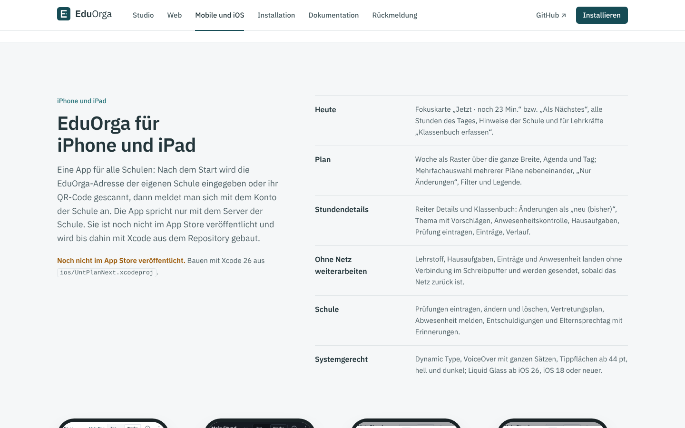
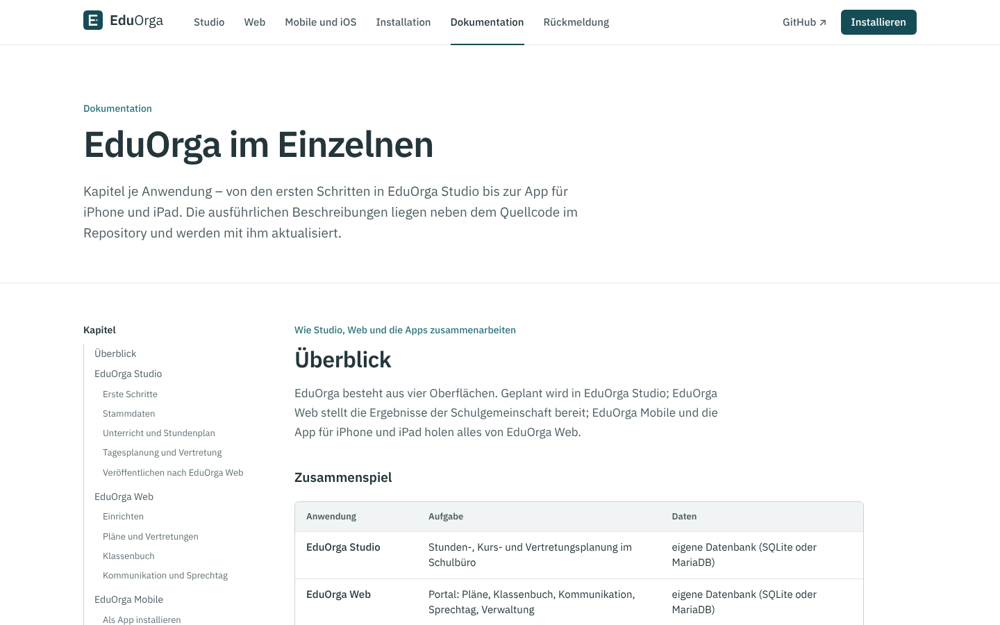
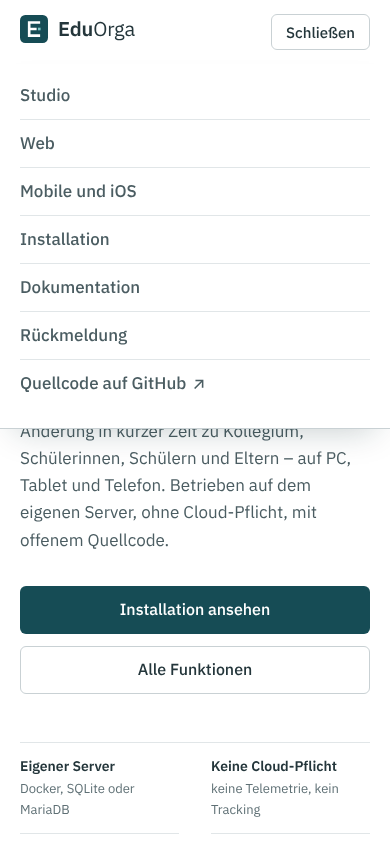
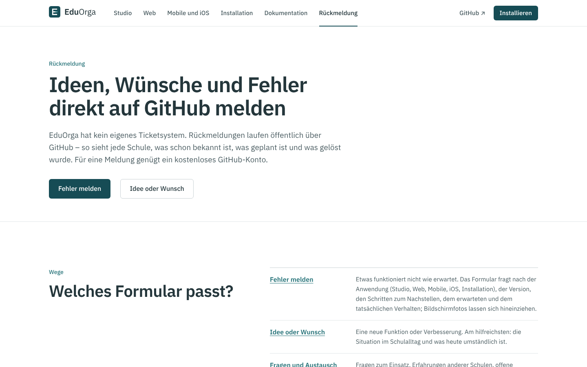

# EduOrga Website

Produkt-Website von **EduOrga** („Einfach mehr Schulalltag.“): Überblick, die Anwendungen Studio, Web, Mobile und die
App für iPhone und iPad mit ehrlichem Stand der Plattformen, Installation Schritt für Schritt, Dokumentation je Anwendung,
Rückmeldung über GitHub sowie Hinweis, Impressum und Datenschutz. Marke, Farben und rechtlicher
Hinweis folgen [`design/MARKE.md`](../design/MARKE.md).

Die Website ist **nicht Teil der Installation an Schulen**. Betrieben wird sie getrennt mit
[`installation/intern/`](../installation/intern/README.md) (nur für den Betreiber des Projekts). Fehler, Wünsche und
Ideen laufen über GitHub: [Issues](https://github.com/florians25/EduOrga/issues) und
[Discussions](https://github.com/florians25/EduOrga/discussions) – ein eigenes Portal gibt es nicht.


| Studio | Mobile und iOS | Installation | Dokumentation |
|---|---|---|---|
|  |  |  |  |

| Telefon | Menü | Rückmeldung | Ganze Startseite |
|---|---|---|---|
|  |  |  | [1440 px](docs/bilder/start-ganz-desktop.png) · [390 px](docs/bilder/start-ganz-telefon.png) |

Weitere Aufnahmen in [`docs/bilder/`](docs/bilder/): `web-desktop.png`, `mobile-desktop.png`, `mobile-telefon.png`,
`installation-telefon.png`, `impressum-desktop.png` (Playwright, Chromium, 1440 × 900 bzw. 390 × 844).

## Seiten

| Adresse | Inhalt |
|---|---|
| `/` | Startseite für Schulleitungen: Leitsatz, Studio im Browserfenster und Wochenplan im iPhone-Rahmen, „Ein Schulmorgen“ (Krankmeldung bis Plan auf dem Telefon), **Stand der Plattformen**, Für wen (Schulleitung, Stundenplanung, Lehrkräfte, Schüler*innen und Eltern), Vertretung in Minuten, Änderungen auf allen Geräten, Klassenbuch, Sprechtag und Mitteilungen, Datenschutz und Betrieb (DSGVO, eigener Server, offener Quellcode, Barrierefreiheit, Druck/PDF, Umstieg), Funktionen je Anwendung, So funktioniert’s, Rückmeldung über GitHub, häufige Fragen |
| `/studio`, `/web` | je Anwendung: Beschreibung, Titelbild, Funktionen, weitere Ansichten, Technik |
| `/mobile` | EduOrga Mobile (PWA), Stand der Apps, `#ios` die App für iPhone und iPad (**noch nicht im App Store veröffentlicht**), `#android` (**in Arbeit**); `/ios` und `/android` leiten dorthin |
| `/installation` | Anleitung in zwölf Schritten nach `installation/README.md` und den Skripten: Voraussetzungen, `install.sh` mit seinen Fragen, Domain und HTTPS (Caddy oder vorhandener Reverse-Proxy mit nginx-Beispiel), erster Login und `passwort.sh`, Studio mit Web verbinden, SQLite oder MariaDB, `update.sh`, Sicherung und Wiederherstellung, Einstellungen, Fehlerbehebung, Deinstallieren |
| `/dokumentation` | Kapitel je Anwendung aus `client/src/doku.ts`: Überblick, Studio (Erste Schritte, Stammdaten, Stundenplan, Tagesplanung und Vertretung, Veröffentlichen), Web, Mobile, iOS, Datenschutz und Rollen, Betrieb; Kapitel des Handbuchs (`docs/HANDBUCH.md`) mit Links auf GitHub; `/handbuch` leitet auf `/dokumentation#handbuch` |
| `/rueckmeldung` | Fehler, Wünsche und Fragen über GitHub – direkt zu den Formularen `.github/ISSUE_TEMPLATE/fehler.yml` und `wunsch.yml` |
| `/hinweis`, `/impressum`, `/datenschutz` | rechtlicher Hinweis und Vorlagen mit Platzhaltern für die Betreiberangaben |

**Bildschirmfotos der iPhone-App:** `vorbereiten.mjs` übernimmt `ios/docs/bilder/plan-woche-hell.png`,
`plan-woche-dunkel.png`, `stunde-details.png` und `stunde-klassenbuch.png` (920 × 2000) nach `public/bilder/ios/`. Fehlt
eine Datei, nimmt es stattdessen das gleich gestaltete Bild von EduOrga Mobile (`mobile/docs/bilder/plan-woche.png`,
`dunkel-plan-woche.png`, `stundendetails.png`, `stundendetails-klassenbuch.png`); die Bildunterschrift nennt das dann.
Der Build schlägt nicht fehl ([`ios/docs/bilder/README.md`](../ios/docs/bilder/README.md)).

**Stand der Plattformen** auf der Startseite: „Entwicklungsstand `<VERSION>` · Noch keine Veröffentlichung (bzw. Aktuelle Version
`<Tag>` vom `<Datum>`) · Letzte Änderung `<Datum>`“ und der Link „Projektstand und Änderungen“ (Releases, solange es keine
gibt die Liste der Commits). Die Werte ermittelt `client/scripts/vorbereiten.mjs` **beim Build** und schreibt sie nach
`client/src/stand.json` (Build-Ausgabe, nicht eingecheckt):

| Wert | Quelle |
|---|---|
| Version | Datei `VERSION` im Repository |
| Letzte Änderung, Commit | `WEBSITE_COMMIT_DATUM`/`WEBSITE_COMMIT`, sonst `git log -1`, sonst Zeitpunkt des Builds |
| Neueste Veröffentlichung | `WEBSITE_RELEASE` (`-` = keine) und `WEBSITE_RELEASE_DATUM`, sonst GitHub-API `releases/latest` (5 s Zeitlimit, `WEBSITE_OFFLINE=1` schaltet die Abfrage ab) |
| Kapitel des Handbuchs | Überschriften `## N. …` in `docs/HANDBUCH.md` |
| Bildschirmfotos der iPhone-App | `ios/docs/bilder/*.png`, sonst Ersatz aus `mobile/docs/bilder` (`echt`, Breite, Höhe je Bild) |

**Datenschutz:** keine externen Schriften, Skripte oder Dienste (Content-Security-Policy `default-src 'self'`), kein
Tracking, keine Cookies, keine Formulare, keine Datenbank.

## Aufbau

```text
website/
├── client/                    Oberfläche: React 18, TypeScript (strict), Vite, React Router – ohne UI-Bibliothek
│   ├── scripts/vorbereiten.mjs  Schrift, Logo (design/), Bildschirmfotos (studio|web|mobile|ios/docs/bilder, docs/bilder/druck) → public/, Stand → src/stand.json
│   └── src/                   seiten/, bausteine/ (Rahmen, Browserfenster, Telefon, Befehle), inhalt.ts (Texte), doku.ts (Dokumentation), stand.ts, stil.css
├── src/EduOrgaWebsite/        Server: ASP.NET Core 8, liefert wwwroot aus (Schutzköpfe, SPA-Rückfall, /api/gesundheit, /api/info)
├── tests/EduOrgaWebsite.Tests xUnit-Tests (WebApplicationFactory)
├── docs/bilder/               Bildschirmfotos (Playwright)
└── Dockerfile                 Image ghcr.io/florians25/untplannext-website
```

Der Server ist bewusst klein: statische Dateien (Assets ein Jahr zwischenspeicherbar, `index.html` mit `no-cache`),
Seitenadressen liefern die `index.html`, `/api/gesundheit` für den Healthcheck und `/api/info` mit Version und
Betreiberangaben (für Impressum und Datenschutz). Bildschirmfotos und Logos werden beim Bauen aus dem Repository
übernommen und nicht doppelt eingecheckt (`client/public/bilder`, `fonts`, `logo` sind Build-Ausgabe).

## Lokal starten

Voraussetzung: .NET 8 SDK und Node.js 22.

```bash
cd website/src/EduOrgaWebsite
ASPNETCORE_URLS=http://127.0.0.1:5520 dotnet run
```

`dotnet build`/`run` baut die Oberfläche mit (`npm ci` beim ersten Mal, dann `npm run build`; abschalten mit
`-p:WebsiteOberflaecheBauen=false`). Dann <http://127.0.0.1:5520> öffnen.

Oberfläche mit sofortiger Aktualisierung:

```bash
cd website/client
npm ci
npm run dev          # Vite auf http://127.0.0.1:5173, leitet /api an WEBSITE_URL (Standard http://127.0.0.1:5520) weiter
npm run typecheck    # Stand erzeugen + tsc --noEmit
npm run build        # Stand erzeugen + Typprüfung + Build nach ../src/EduOrgaWebsite/wwwroot
```

Tests:

```bash
dotnet test website/tests/EduOrgaWebsite.Tests -c Release
```

Sie prüfen: alle Seitenadressen liefern die Oberfläche (ohne Cookies), jede dieser Adressen steht als Route in `client/src/main.tsx`, Schutzköpfe und Content-Security-Policy,
Zwischenspeichern der Assets, Gesundheit, Betreiberangaben aus der Umgebung, frühere Portaladressen antworten mit 404.

## Einstellungen (Umgebungsvariablen)

| Variable | Standard | Bedeutung |
|---|---|---|
| `WEBSITE_BETREIBER_NAME`, `…_ANSCHRIFT`, `…_EMAIL` | – | Angaben für Impressum und Datenschutz (leer = Platzhalter) |

`dotnet EduOrgaWebsite.dll --gesundheitspruefung` dient dem Docker-Healthcheck.

## Container und Betrieb

Das Image baut der Workflow `.github/workflows/website.yml` als `ghcr.io/florians25/untplannext-website` (amd64 und
arm64; Tag `v1.2.3` → Version `1.2.3`, sonst `<VERSION>-dev.<Lauf>`; Commits mit `[skip ci]` werden übersprungen). Er
übergibt Commit, Datum der letzten Änderung und die neueste Veröffentlichung als Build-Argumente für die Statusleiste.
Selbst bauen (Build-Kontext = Repository-Wurzel):

```bash
docker build -f website/Dockerfile -t untplannext-website \
  --build-arg WEBSITE_COMMIT_DATUM="$(git log -1 --format=%cI)" --build-arg WEBSITE_COMMIT="$(git rev-parse HEAD)" .
docker run -p 8290:8080 untplannext-website
```

Betrieb auf dem Server: [`installation/intern/README.md`](../installation/intern/README.md) (`installation/install-intern.sh`,
Port 8290, optional eigener Caddy für HTTPS). Vor der Veröffentlichung Impressum- und Datenschutzangaben setzen und die
Texte (Vorlagen, keine Rechtsberatung) prüfen.

## Hinweis

EduOrga ist ein privates Hobbyprojekt eines Auszubildenden zum Fachinformatiker für Systemintegration, entwickelt mit
Unterstützung von Claude (Anthropic). Jede Schule bzw. jeder Betreiber ist für Einsatz, Betrieb und Datenschutz selbst
verantwortlich.
